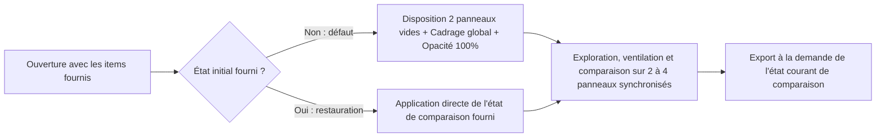

# Spécification fonctionnelle : Comparaison de visualisations d'imagerie (V1)

## 1. Objectif et scénarios prioritaires

### 1.1 Objectif
Fournir aux analystes géospatiaux et scientifiques un environnement visuel et cartographique interactif permettant de comparer simultanément de 2 à 4 groupes de données géospatiales. Ces groupes sont affichés dans 2 à 4 panneaux synchronisés, avec un groupe par panneau. L'objectif est d'évaluer à travers le temps ou à travers différents capteurs les différences d’une même observation.

### 1.2 Scénarios prioritaires
1. **Observation de l'évolution temporelle et multi-capteurs** : Comparer des images acquises à des dates différentes ou par des capteurs distincts (ex: Sentinel-2, Landsat-8) sur une même emprise géographique.
2. **Comparaison multi-spectrale / représentations différentes** : Comparer un même item (ou ensemble d'items) affiché sous différentes visualisations spectrales distinctes (ex. composition naturelle B04/B03/B02 vs composition fausse couleur infrarouge B08/B04/B03 pour l'analyse du couvert végétal).



## 2. Vocabulaire fonctionnel

* **Item** : Donnée élémentaire d'observation de la Terre caractérisée au minimum par son identifiant, son emprise géographique, sa date/heure d'acquisition (exprimée en UTC) et sa constellation, complétée de métadonnées descriptives dépendant du capteur ou de la collection (ex. capteur, couverture nuageuse, polarisation).
* **Visualisation** : Rendu cartographique d'imagerie paramétré appliqué à un item (ex. Vraies couleurs, Fausse couleur IR, indices spectraux NDVI/NDWI), indépendamment de son format de diffusion sous-jacent.
* **Groupe** : Ensemble d’items affectés à un même panneau (composant une mosaïque géographique s'ils sont contigus ou une pile superposée s'ils se chevauchent). Le groupe est visualisé dans un panneau unique.
* **Panneau** : Fenêtre cartographique autonome affichant un groupe d'items partageant une même visualisation et synchronisée en continu avec les autres panneaux.
* **Balayage** *(communément appelé swipe)* : Mode de comparaison visuelle à 2 panneaux superposés dans un même cadre, séparés par une poignée verticale mobile révélant le Panneau 1 à gauche et le Panneau 2 à droite.
* **Volet latéral d'affectation** : Panneau escamotable à gauche listant les items disponibles à la comparaison (triés du plus récent au plus ancien) et offrant une grille de sélection calquée sur la disposition active pour ventiler chaque item dans les panneaux.
* **Auto-assignation** : Mécanisme répartissant automatiquement et de manière déterministe les items visualisables dans les 2 à 4 panneaux de la disposition active selon la constellation, la date / période d'acquisition, ou en plaçant tous les items dans chaque panneau.
* **État de comparaison (ou Configuration de comparaison)** : Ensemble des caractéristiques fonctionnelles décrivant une session de comparaison à un instant donné : disposition active (et position de la poignée en mode Balayage), affectation et mode d'affectation (Choix unique / Multi-panneaux) des items par panneau, visualisation active de chaque panneau, niveau d'opacité globale, paramètres de vue cartographique synchronisée (cadrage géographique, orientation, inclinaison, relief 3D/2D, fond de carte) et état ouvert/rétracté du volet latéral.

## 3. Périmètre V1, reporté (V2) et hors périmètre

### 3.1 Périmètre de la V1
* Vue de comparaison plein écran autonome et indépendante de son contexte d'appel.
* Cadrage géographique initial automatique à l'ouverture sur l'emprise englobante de l'ensemble des items fournis (par défaut lorsqu'aucun état initial n'est fourni).
* **Initialisation à partir d'un état de comparaison** : possibilité d'ouvrir directement la vue de comparaison dans une configuration préétablie (disposition et position du séparateur de balayage, items placés dans les panneaux et modes d'affectation associés, visualisations actives par panneau, opacité globale, paramètres de vue cartographique synchronisée et état du volet latéral). Tout paramètre non précisé dans l'état fourni prend sa valeur par défaut ; tout item absent des items fournis (ou sans visualisation) est ignoré sans bloquer l'ouverture, et toute visualisation devenue incompatible avec l'ensemble des items d'un panneau retombe sur la visualisation par défaut du premier item de ce panneau.
* **Export de l'état de comparaison** : possibilité d'extraire à tout moment l'état courant complet de la vue de comparaison via une action dédiée, afin de permettre à l'utilisateur ou à l'écran appelant de le conserver, de le partager ou de rouvrir ultérieurement la vue dans cette exacte configuration.
* Référentiel horaire unifié : toutes les dates et heures de la vue sont affichées en **temps universel coordonné (UTC)** à la minute près (`JJ/MM/AAAA HH:mm UTC`).
* Comparaison de 2 à 4 groupes présentés dans 2 à 4 panneaux simultanés, un groupe par panneau (aucune disposition à 1 panneau).
* Nombre d'items illimité par panneau : mosaïque s'ils sont contigus ; en cas de chevauchement en V1, empilement déterministe par date d'acquisition croissante (l'item le plus récent affiché au-dessus, et tri par identifiant en cas d'égalité).
* Modes de visualisation : **Côte à côte** (2 à 4 panneaux) et **Balayage** (strictement réservé à 2 panneaux, avec poignée verticale initialisée par défaut au centre à 50 %, en-tête et légende du Panneau 1 ancrés à gauche et ceux du Panneau 2 ancrés à droite).
* Dispositions proposées à l'utilisateur :
  * **2 panneaux côte à côte** (gauche/droite) — **disposition active par défaut à l'ouverture sans état initial fourni** — ou **Balayage** (2 panneaux). Le basculement entre « Côte à côte » et « Balayage » conserve intégralement les groupes `P1` et `P2` ainsi que leurs visualisations actives.
  * **3 colonnes** (3 panneaux alignés à l’horizontale occupant chacun un tiers de la largeur).
  * **Grille 2x2** (4 panneaux).
  * *Réduction du nombre de panneaux* : le passage à une disposition comportant moins de panneaux désaffecte immédiatement les items des panneaux retirés (ex. `P3` et `P4` sont vidés lors d'un passage de 4 à 2 panneaux, rendant leurs items libres dans le volet latéral sans état caché).
  * *Ajout d'un panneau (augmentation du nombre de panneaux)* : le passage à une disposition comportant davantage de panneaux (de 2 à 3 ou 4 panneaux, ou de 3 à 4 panneaux) conserve intégralement les groupes existants ainsi que leurs visualisations actives (ex. `P1` et `P2`), bascule en mode « Côte à côte » si la vue était en « Balayage », ouvre le ou les nouveaux panneaux (`P3`, `P4`) à l'état vide sur le fond de carte synchronisé (*« Panneau Pn — Aucun item assigné »*), et étend la grille de boutons d'affectation (`[P1]..[PN]`) dans le volet latéral sans relancer d'auto-assignation.
* Gestion des états particuliers (panneaux vides, items sans visualisation, chargements et erreurs) :
  * **Panneau vide** : un panneau sans item assigné affiche uniquement le fond de carte synchronisé et un en-tête neutre *« Panneau Pn — Aucun item assigné »*, en masquant ses métadonnées, sa légende et son sélecteur de visualisation.
  * **Item sans visualisation** : un item dépourvu de toute visualisation configurée apparaît dans le volet latéral avec ses contrôles d'affectation désactivés et la mention *« Aucune visualisation disponible »*, et est ignoré par l'auto-assignation.
  * **Chargement en cours** : pendant le chargement d'un ou plusieurs items d'un panneau, un indicateur visuel de progression non bloquant s'affiche dans ce panneau sans figer la navigation synchronisée.
  * **Erreur d'affichage** : en cas d'échec de chargement d'un item, les autres items valides du panneau restent normalement affichés tandis que la carte de l'item défaillant signale une erreur dans le volet latéral ; si tous les items compatibles du panneau échouent, le panneau affiche un message d'erreur explicite tout en conservant son en-tête et la possibilité de changer de visualisation.
* Synchronisation cartographique totale et continue (**déplacement, zoom, orientation vers le Nord, inclinaison, relief 3D et fond de carte**) sans désactivation possible.
* Visualisation indépendante par panneau avec sélecteur dédié et légende affichant la valeur radiométrique au survol :
  * **Initialisation** : lorsqu'un premier item (ou groupe d'items) est affecté à un panneau vide (sans visualisation imposée par un état initial), le panneau adopte la visualisation par défaut du premier item du groupe (le plus récent), ou à défaut la première visualisation disponible pour cet item.
  * **Maintien et recalcul** : lorsqu'un panneau possède déjà une visualisation active, l'ajout ou le retrait d'items ne modifie pas cette visualisation, sauf si le retrait du dernier item compatible rend la visualisation active indisponible pour tous les items restants du panneau — auquel cas le panneau bascule automatiquement sur la visualisation par défaut du premier item restant.
  * **Hétérogénéité** : en présence d'items multi-capteurs / constellations au sein d'un même panneau, le sélecteur propose **l'union** des visualisations disponibles des items du groupe. Tout item du groupe ne supportant pas la visualisation active n'est pas affiché sur la carte de ce panneau et signale cette incompatibilité par un badge d'avertissement dans le volet latéral.
  * **Lecture synchronisée au survol** : le survol d'une coordonnée géographique sur la carte affiche simultanément, dans la légende de chaque panneau actif (quelle que soit l'opacité globale choisie, y compris à 0 %), la valeur radiométrique de l'item visible au sommet à cette coordonnée, ou la mention **`« — »` (Aucune donnée)** si la coordonnée est hors de l'emprise des items affichés du panneau ou dépourvue de valeur.
* Curseur d'opacité globale unique (de 0 % à 100 %, **initialisé à 100 % par défaut en l'absence d'état initial fourni**) pour révéler le fond de carte de référence sous les différents panneaux.
* Métadonnées d'en-tête de panneau actif, calculées **exclusivement sur les items compatibles et effectivement affichés** dans le panneau : Constellation(s), Visualisation active, Date moyenne arithmétique stricte (`JJ/MM/AAAA HH:mm UTC`), et Étendue temporelle sous la forme **`Du [Date/heure min] au [Date/heure max] UTC`** (masquée lorsqu'un seul item est affiché ou lorsque tous les items affichés partagent exactement la même date/heure d'acquisition à la minute près).
* Volet latéral d'affectation escamotable, triant les items par **date d'acquisition décroissante** (plus récent en haut), où chaque entrée associe une **fiche descriptive en carte** (vignette d'aperçu, titre et métadonnées configurées avec dates en UTC, sans case à cocher de sélection, action rapide **« Centrer sur l'item »** et mise en surbrillance temporaire du **contour de l'emprise sur les panneaux au survol**) et un **bandeau inférieur d'affectation** regroupant le commutateur individuel de mode (**« Choix unique » actif par défaut hors état initial fourni** avec bouton actif décochable au clic, ou **« Multi-panneaux »** ; repli conservant le premier panneau dans l'ordre `P1` à `P4`), les indicateurs d'état et la grille de boutons `[P1]..[PN]` reproduisant la disposition active.
* Auto-assignation déterministe s'appuyant sur le nombre de panneaux (2, 3 ou 4) de la disposition active (appliquée aux seuls items disposant d'au moins une visualisation) :
  * *Règles communes* : toute auto-assignation **réinitialise intégralement** les affectations et visualisations précédentes. Si le nombre de groupes générés est inférieur au nombre de panneaux de la disposition active, la disposition n'est pas modifiée et les panneaux surnuméraires restent vides sur fond de carte.
  * **Par constellation** : place tous les items visualisables en mode *Choix unique* et les regroupe par constellation. Les panneaux `P1` à `PN` sont remplis par **effectif décroissant puis ordre alphabétique**. Si le nombre de constellations dépasse le nombre de panneaux, seules les constellations les plus représentées sont retenues (en cas d'égalité d'effectifs, départage par **date d'acquisition la plus récente** puis ordre alphabétique) ; les items des constellations minoritaires restent non assignés dans le volet latéral.
  * **Par date / période d'acquisition** : place tous les items visualisables en mode *Choix unique* et répartit 100 % d'entre eux dans les panneaux en minimisant l’étalement temporel intra-groupe et en maximisant les écarts inter-groupes (aucun item visualisable laissé sans assignation). Les items partageant exactement la même date/heure d'acquisition sont **inséparables** et appartiennent toujours au même groupe ; en cas d'équidistance temporelle stricte entre deux groupes, l'item médian est rattaché au groupe **le plus récent**. Les panneaux `P1` à `PN` sont remplis par **ordre chronologique croissant** (du groupe le plus ancien dans `P1` au plus récent).
  * **Tous les items dans chaque panneau** : place tous les items visualisables en mode *Multi-panneaux* et les affecte à chacun des panneaux actifs. Chaque panneau est initialisé avec la visualisation par défaut du premier item (le plus récent), ou la première disponible sinon.
* Retrait unitaire d’un item d’un groupe via le volet latéral (par clic sur le bouton actif en mode Choix unique ou désélection en mode Multi-panneaux).
* Contrôles cartographiques mutualisés (bloc unique global pour toute la zone cartographique) : Zoom (+), Dézoom (-), Déplacement, Réinitialiser le Nord (boussole), Bascule Relief 3D / Vue 2D et Sélecteur de fond de carte.

### 3.2 Fonctionnalités reportées (V2)
* Gestion manuelle et personnalisation de l'ordre de superposition des couches de visualisation au sein d'un même panneau.
* Gestion d'une bibliothèque de sauvegardes et génération de liens de partage pérennes (au-delà de la fourniture et de l'export de l'état de comparaison pris en charge dès la V1).

### 3.3 Hors périmètre strict
* Conditions d'entrée dans le mode comparaison et sélection amont des items (responsabilité de l'écran appelant).
* Mode Globe (projection sphérique 3D).
* Désynchronisation de la navigation ou du fond de carte entre panneaux.
* Comparaison simultanée de plus de 4 panneaux (ou disposition à 1 seul panneau).

## 4. Parcours utilisateur

### 4.1 Parcours nominal : Comparaison multi-dates de 3 items
1. À l'ouverture sans état initial fourni, la vue se cadre automatiquement sur l'emprise englobante des 3 items fournis et l'opacité globale est à **100 %**. La disposition **« 2 panneaux côte à côte »** (vides sur fond de carte, en-têtes *« Panneau P1 / P2 — Aucun item assigné »*) est sélectionnée par défaut et aucun item n'est affecté aux panneaux (manuel strict). Le volet latéral gauche est déployé et liste les 3 items triés du plus récent au plus ancien (dates en UTC), en mode « Choix unique » par défaut avec les boutons `[P1] [P2]`. Au survol d'une carte dans le volet, le contour de l'emprise de l'item s'illumine sur les panneaux.
2. L'utilisateur choisit la disposition **« 3 colonnes »** : la zone cartographique affiche 3 panneaux vides et la grille de boutons de chaque item passe à `[P1] [P2] [P3]`.
3. L'utilisateur clique sur « Auto-assigner » et sélectionne le critère **« Par date / période d'acquisition »**.
4. Le regroupement temporel répartit les 3 items par ordre chronologique croissant de `P1` (le plus ancien) à `P3` (le plus récent), avec affichage d'un indicateur de progression non bloquant dans chaque panneau durant le chargement.
5. Chaque panneau affiche la visualisation par défaut de son item ainsi que son en-tête (constellation, nom de la visualisation, date moyenne au format `JJ/MM/AAAA HH:mm UTC` ; l'étendue temporelle est masquée car chaque panneau ne contient qu'un seul item affiché).
6. L’utilisateur choisit une visualisation différente dans chaque panneau, puis survole une parcelle d'intérêt : les légendes de `P1`, `P2` et `P3` affichent simultanément la valeur radiométrique de ce point géographique à chacune des 3 dates (et affichent `« — »` pour tout panneau dont l'item ne couvrirait pas le point survolé).
7. L'utilisateur déplace la carte, zoome ou change le fond de carte via le bloc de contrôles global : l'ensemble des 3 panneaux réagit de façon synchronisée.
8. L'utilisateur ajuste le curseur d'opacité globale de 100 % à 80 % : le fond de carte de référence transparaît uniformément sous les 3 panneaux tandis que la lecture des valeurs au survol demeure active.
9. L'utilisateur clique sur « Fermer » : la vue de comparaison se ferme et l'utilisateur retrouve l'écran appelant.

### 4.2 Parcours alternatif 1 : Comparaison de 2 visualisations d'un même item (Scénario 2)
1. À l'ouverture avec un unique item, la carte est cadrée sur l'emprise de cet item et la disposition **« 2 panneaux côte à côte »** est active par défaut.
2. Dans le volet latéral gauche, sur la carte de l’item (initialement en mode « Choix unique »), l'utilisateur active le mode **« Multi-panneaux »** via le commutateur d'affectation.
3. Sur la carte de cet item, l'utilisateur sélectionne `P1` et `P2`.
4. Le Panneau 1 et le Panneau 2 chargent tous les deux la visualisation par défaut de l'item.
5. Sur le Panneau 1, l'utilisateur clique sur le sélecteur de visualisation et choisit « Vraies couleurs (B04/B03/B02) ».
6. Sur le Panneau 2, l'utilisateur choisit « Fausse couleur Infrarouge (B08/B04/B03) ».
7. Les deux panneaux affichent les deux visualisations spectrales distinctes du même item (sans étendue temporelle affichée puisque chaque panneau ne compte qu'un item).
8. L'utilisateur bascule sur la disposition **« Balayage »** : les groupes `P1` et `P2` ainsi que leurs visualisations respectives sont intégralement conservés, l'en-tête et la légende de `P1` s'ancrent à gauche, ceux de `P2` à droite, et la poignée verticale centrée par défaut à **50 %** permet de balayer entre la vue naturelle et la vue infrarouge tout en comparant simultanément leurs valeurs au survol.

### 4.3 Parcours alternatif 2 : Dépassement du nombre de groupes lors de l'auto-assignation par constellation et hétérogénéité
1. L'utilisateur ouvre la vue de comparaison avec 8 items répartis sur 6 constellations différentes.
2. Il choisit la disposition **« Grille 2x2 »** (4 panneaux).
3. L'utilisateur clique sur « Auto-assigner » et sélectionne le critère **« Par constellation »**.
4. Le partitionnement identifie 6 constellations distinctes (> 4 panneaux disponibles).
5. L'application réinitialise les panneaux et affecte à `P1..P4` (par effectif décroissant, et en cas d'égalité par date d'acquisition la plus récente puis ordre alphabétique) les 4 constellations retenues, en laissant les items des 2 constellations restantes sans assignation dans le volet latéral.
6. L'utilisateur affecte manuellement l'un des items restants au Panneau `P1` : la visualisation active de `P1` est conservée et son sélecteur propose désormais l'union des visualisations du groupe. Si cet item ajouté ne supporte pas la visualisation active de `P1`, il reste masqué sur la carte de `P1`, signale un badge d'incompatibilité dans le volet latéral, et est exclu du calcul des métadonnées d'en-tête de `P1`.
7. Si l'utilisateur bascule ensuite sur la disposition **« Côte à côte »** (2 panneaux), les panneaux `P3` et `P4` sont supprimés et leurs items redeviennent immédiatement non assignés dans le volet latéral. S'il passe ensuite à **« 3 colonnes »**, les groupes et visualisations de `P1` et `P2` sont conservés et un troisième panneau `P3` s'ouvre à l'état vide.

### 4.4 Parcours alternatif 3 : Retrait d'items, recalcul de visualisation et maintien d'un panneau vide
1. Une disposition **« 3 colonnes »** est sélectionnée et le Panneau 2 contient 2 items de dates différentes (superposés avec l'acquisition la plus récente au-dessus, et affichage de la date moyenne ainsi que de l'étendue temporelle `Du ... au ... UTC`).
2. L'utilisateur retire un premier item du Panneau 2 (en cliquant sur le bouton actif `P2` en mode Choix unique, ou en désélectionnant `P2` en mode Multi-panneaux) : l’item disparaît du Panneau 2, l'étendue temporelle est masquée puisqu'il ne reste qu'un seul item, et si la visualisation active n'est pas supportée par l'item restant, le panneau bascule automatiquement sur la visualisation par défaut de cet item restant.
3. L'utilisateur retire le dernier item restant dans le Panneau 2.
4. Le Panneau 2 ne contient plus aucun item : il reste ouvert sur le fond de carte synchronisé, masque sa légende et son sélecteur de visualisation, et affiche l'en-tête neutre *« Panneau P2 — Aucun item assigné »*.

### 4.5 Parcours alternatif 4 : Export et réouverture avec un état de comparaison
1. L'utilisateur configure une analyse en disposition **« Grille 2x2 »**, répartit plusieurs items dans `P1`, `P2` et `P3`, choisit des visualisations spécifiques par panneau, règle l'opacité globale à 70 % et zoome sur une zone d'intérêt en relief 3D.
2. L'utilisateur déclenche l'action **« Exporter l'état »** depuis la barre supérieure : l'état courant complet de la comparaison est extrait.
3. Ultérieurement, la vue de comparaison est ouverte directement avec les items correspondants accompagnés de cet état de comparaison.
4. La vue restaure immédiatement la disposition **« Grille 2x2 »**, replace les items dans `P1`, `P2` et `P3` avec leurs modes d'affectation et leurs visualisations respectives, laisse `P4` vide, positionne l'opacité globale à 70 % et rétablit le cadrage exact ainsi que le relief 3D.

## 5. Ergonomie

```
+-------------------------------------------------------------------------------------------------------------+
| Disposition: [*Côte à côte*] [3 colonnes] [Grille 2x2] [Balayage] Opacité: [--O] 100% | [Exporter] [Fermer] |
+------------------------+-----------------------------------------+------------------------------------------+
| VOLET LATÉRAL [<]      | EN-TÊTE P1: Sentinel-2 | Visu | Date UTC| EN-TÊTE P2: Panneau P2 — Aucun item      |
| [Auto-assigner v]      | [Changer visu]                          |                                          |
|------------------------|-----------------------------------------+------------------------------------------|
| [Vignette] Titre_Item  |                                         |                                          |
|  Métadonnées (UTC...)  |             CARTE PANNEAU 1             |             CARTE PANNEAU 2              |
|  Actions: [Centrer]    |                                         |          (Fond de carte nu)              |
| - - - - - - - - - - - -|                                         |                                          |
|  [1/Mul] (*P1*)( P2 )  | [Légende P1 (valeur sync. / « — »)]     |                                          |
|------------------------|-----------------------------------------+------------------------------------------|
| [Vignette] Item_Ancien |               CONTRÔLES CARTO MUTUALISÉS (Zone cartographique globale)             |
|  - - - - - - - - - - - |                 [Zoom + / -]  [Boussole]  [Relief 3D/2D]  [Fond de carte]          |
|  [1/Mul] ( P1 )( P2 )  |                                                                                    |
+------------------------+------------------------------------------------------------------------------------+
```

### 5.1 Barre de contrôle supérieure (Globale)
* **Bouton Fermer** : Ferme la vue de comparaison et ramène l'utilisateur à l'écran appelant.
* **Bouton Exporter l'état** : Extrait à tout moment l'état courant complet de la comparaison (disposition, groupes d'items et modes d'affectation, visualisations actives, opacité globale, paramètres cartographiques synchronisés et état du volet) afin de pouvoir restituer ultérieurement la session à l'identique.
* **Sélecteur de disposition exclusif** : Boutons « Côte à côte » (2 panneaux, actif par défaut à l'ouverture sans état initial fourni), « 3 colonnes », « Grille 2x2 » et « Balayage » (2 panneaux). Le passage entre « Côte à côte » et « Balayage » conserve les groupes `P1`/`P2` et leurs visualisations ; l'ajout de panneaux (passage à 3 ou 4 panneaux) conserve intégralement les groupes et visualisations existants et ouvre les nouveaux panneaux à l'état vide ; toute réduction du nombre de panneaux désaffecte immédiatement les items des panneaux retirés.
* **Curseur d'opacité globale** : Curseur de 0 % à 100 % (**initialisé à 100 % par défaut en l'absence d'état initial fourni**) modifiant simultanément l'opacité de toutes les visualisations de tous les panneaux sans interrompre la lecture des valeurs au survol.

### 5.2 Volet latéral d'affectation (Gauche)
* **Rétractabilité** : Le volet peut être réduit ou masqué pour maximiser l'espace cartographique, puis redéployé.
* **Bouton Auto-assigner** : Menu déroulant proposant 3 options (qui ignorent les items dépourvus de visualisation et réinitialisent intégralement les affectations et visualisations précédentes avant application) :
  1. « Par constellation » (remplissage de `P1` à `PN` par effectif décroissant puis ordre alphabétique ; départage des égalités par date la plus récente puis ordre alphabétique).
  2. « Par date / période d'acquisition » (items de même date/heure inséparables ; rattachement au groupe le plus récent en cas d'équidistance ; remplissage de `P1` à `PN` par ordre chronologique croissant, du plus ancien au plus récent).
  3. « Tous les items dans chaque panneau » (affectation de tous les items visualisables en mode Multi-panneaux sur tous les panneaux de la disposition active).
* **Liste des items disponibles à la comparaison** : Triée par **date d'acquisition décroissante** (plus récent en haut, puis par identifiant en cas d'égalité), chaque item est présenté sous forme d'une carte composite structurée en deux zones superposées (dont le survol global met temporairement en surbrillance le **contour de l'emprise sur tous les panneaux**) :
  1. **Zone supérieure — Fiche descriptive de l'item** (homogène avec les cartes de résultats existantes) :
     * Vignette d'aperçu visuel (avec possibilité d'agrandissement de l'aperçu, et **sans case à cocher de sélection** puisque tous les items listés composent déjà le périmètre de comparaison).
     * Titre et lignes de métadonnées descriptives configurées pour les items (ex. identifiant, date/heure d'acquisition au format `JJ/MM/AAAA HH:mm UTC`, constellation, couverture nuageuse ou attributs propres au capteur), ainsi qu'un accès optionnel aux détails complémentaires de l'item.
     * Action **« Centrer sur l'item »** permettant de cadrer les cartes synchronisées sur l'emprise géographique de cet item.
  2. **Zone inférieure — Bandeau d'affectation aux panneaux et indicateurs d'état** :
     * **Commutateur de mode d'affectation par item** (désactivé avec mention *« Aucune visualisation disponible »* si l'item n'en possède aucune) permettant d'alterner entre :
       * **Mode « Choix unique » (actif par défaut hors état initial fourni)** : boutons exclusifs `[P1]..[PN]` affectant l'item à un seul panneau au maximum. Un clic sur le bouton déjà actif désélectionne le panneau et retire l'item sans avoir à changer de mode.
       * **Mode « Multi-panneaux »** : boutons à sélection multiple `[P1]..[PN]` permettant d'affecter l'item à plusieurs panneaux simultanément.
       * *Règle de repli* : si un item affecté à plusieurs panneaux est rebasculé du mode « Multi-panneaux » vers le mode « Choix unique », seul le premier panneau sélectionné dans l'ordre `P1` à `P4` est conservé et l'item est retiré des autres panneaux.
     * **Grille miroir des boutons d'affectation** :
       * `[P1] [P2]` en disposition « Côte à côte » ou « Balayage » (par défaut à l'ouverture).
       * `[P1] [P2] [P3]` en disposition « 3 colonnes ».
       * `[P1] [P2]` / `[P3] [P4]` (sur 2 lignes) en disposition « Grille 2x2 ».
     * **Indicateurs d'état par item** :
       * *Aucune visualisation* : mention *« Aucune visualisation disponible »* et contrôles d'affectation inactifs.
       * *Incompatibilité de visualisation* : badge d'avertissement lorsque l'item est assigné à un panneau dont la visualisation active n'est pas disponible pour cet item.
       * *Erreur de chargement* : badge d'erreur lorsque le flux de visualisation de l'item n'a pas pu être chargé dans un panneau.

### 5.3 Zone cartographique globale et contrôles mutualisés
À l'ouverture sans cadrage fourni dans un état initial, la zone cartographique se cadre automatiquement sur l'emprise englobante de tous les items fournis. L'ensemble des paramètres de vue et de fond de plan étant synchronisé en permanence sur tous les panneaux, la zone cartographique expose **un unique bloc de contrôles mutualisés** agissant simultanément sur les 2 à 4 panneaux :
* `Zoomer` (+) et `Dézoomer` (-).
* `Boussole` (réinitialisation de l'orientation vers le Nord).
* `Relief 3D / Vue 2D` (bascule synchronisée du terrain).
* `Sélecteur de fond de carte` (choix synchronisé du fond cartographique de référence).

### 5.4 Panneau cartographique individuel
* **Barre d'en-tête de panneau** :
  * *Si le panneau contient au moins un item affiché* (métadonnées calculées exclusivement sur les items compatibles avec la visualisation active et effectivement rendus sans erreur dans le panneau) :
    * Nom de la ou des constellations des items affichés.
    * Nom de la visualisation active (initialisée sur celle par défaut du premier item du groupe — le plus récent — et conservée lors des ajouts/retraits tant qu'au moins un item du groupe la supporte).
    * Date moyenne arithmétique stricte des items affichés (`JJ/MM/AAAA HH:mm UTC`).
    * Étendue temporelle sous la forme **`Du [JJ/MM/AAAA HH:mm] au [JJ/MM/AAAA HH:mm] UTC`**, affichée uniquement si au moins deux items affichés dans le panneau ont des dates/heures d'acquisition différentes à la minute près (masquée si 1 seul item affiché ou dates identiques).
    * Bouton « Changer la visualisation » proposant l'union des visualisations disponibles parmi tous les items assignés au groupe.
  * *Si des items sont assignés mais que tous les items compatibles sont en échec de chargement* :
    * Maintien de l'en-tête avec le nom de la visualisation active et le bouton « Changer la visualisation », et affichage d'un message d'erreur explicite dans le panneau.
  * *Si le panneau ne contient aucun item assigné* :
    * Affichage d'un en-tête épuré *« Panneau Pn — Aucun item assigné »*, sans métadonnées ni bouton « Changer la visualisation ».
  * *Positionnement en mode Balayage* : afin d'éviter toute superposition dans le cadre partagé (séparé par une poignée verticale initialisée à 50 %), l'en-tête et la légende du Panneau 1 sont ancrés à gauche de la vue, et ceux du Panneau 2 sont ancrés à droite.
* **Éléments propres au panneau** :
  * Indicateur visuel de progression non bloquant affiché pendant le chargement des items du panneau.
  * Rendu des items valides du groupe supportant la visualisation active, empilés par date d'acquisition croissante (le plus récent au-dessus, et par identifiant en cas d'égalité), ou message d'erreur explicite si aucun item compatible n'a pu être chargé.
  * Légende affichant en temps réel et de façon synchronisée sur tous les panneaux actifs (quelle que soit l'opacité globale) la valeur radiométrique de l'item visible au sommet sous la coordonnée géographique survolée par le curseur, ou **`« — »` (Aucune donnée)** hors emprise / sans valeur (légende masquée si le panneau ne contient aucun item affiché).

## 6. Règles fonctionnelles (RF)

### 6.1 Ouverture, cadrage initial et référentiel horaire
* **RF-01** : La vue de comparaison s'affiche en plein écran de manière autonome et indépendante de son contexte d'appel ; l'action sur le bouton « Fermer » clôt la vue et ramène l'utilisateur à l'écran appelant.
* **RF-02** : En l'absence de cadrage fourni dans un état initial, la zone cartographique se cadre automatiquement à l'ouverture sur l'emprise géographique englobante de l'ensemble des items fournis.
* **RF-03** : En l'absence d'état initial fourni à l'ouverture, la disposition « 2 panneaux côte à côte » est sélectionnée par défaut et aucun item n'est pré-affecté aux panneaux (état initial manuel strict).
* **RF-04** : Toutes les dates et heures affichées dans la vue de comparaison (volet latéral et en-têtes de panneaux) sont exprimées en temps universel coordonné (UTC) avec une précision à la minute (`JJ/MM/AAAA HH:mm UTC`).

### 6.2 Panneaux, groupes et superposition des items
* **RF-05** : La vue de comparaison supporte de 2 à 4 panneaux cartographiques simultanés, à raison d'un groupe d'items par panneau (aucune disposition à 1 panneau ni à plus de 4 panneaux).
* **RF-06** : Chaque panneau accepte un nombre illimité d'items. Les items contigus composent une mosaïque géographique ; en cas de chevauchement en V1, les items sont empilés de manière déterministe par date d'acquisition croissante (l'item le plus récent affiché au-dessus, et par ordre alphabétique d'identifiant en cas d'égalité), la personnalisation manuelle de l'ordre de superposition étant reportée en V2.
* **RF-07** : Un panneau ne contenant aucun item assigné demeure ouvert dans la disposition active : il affiche uniquement le fond de carte synchronisé ainsi qu'un en-tête épuré *« Panneau Pn — Aucun item assigné »*, en masquant ses métadonnées, sa légende et son sélecteur de visualisation.

### 6.3 Dispositions et modes de comparaison
* **RF-08** : Le sélecteur exclusif de disposition propose quatre options : « Côte à côte » (2 panneaux gauche/droite, actif par défaut à l'ouverture), « Balayage » (2 panneaux), « 3 colonnes » (3 panneaux alignés horizontalement occupant chacun un tiers de la largeur) et « Grille 2x2 » (4 panneaux).
* **RF-09** : En mode « Balayage » (strictement réservé à 2 panneaux), les deux panneaux partagent le même cadre séparé par une poignée verticale mobile initialisée au centre (50 %), révélant la pile complète du Panneau 1 à gauche et celle du Panneau 2 à droite ; l'en-tête et la légende de `P1` sont ancrés à gauche et ceux de `P2` à droite.
* **RF-10** : Le basculement entre « Côte à côte » (2 panneaux) et « Balayage » (2 panneaux) conserve intégralement les groupes `P1` et `P2` ainsi que leurs visualisations actives.
* **RF-11** : Le passage à une disposition comportant moins de panneaux désaffecte immédiatement les items des panneaux retirés (ex. `P3` et `P4` lors d'un passage de 4 à 2 panneaux), rendant ces items libres dans le volet latéral sans état caché.
* **RF-12** : Le passage à une disposition comportant davantage de panneaux (de 2 à 3 ou 4 panneaux, ou de 3 à 4 panneaux) conserve intégralement les groupes des panneaux existants ainsi que leurs visualisations actives (en revenant en mode « Côte à côte » si le mode « Balayage » était actif), ouvre le ou les nouveaux panneaux à l'état vide (*« Panneau Pn — Aucun item assigné »*) sur le fond de carte synchronisé, et met à jour la grille de boutons `[P1]..[PN]` dans le volet latéral sans relancer d'auto-assignation.

### 6.4 Synchronisation et contrôles cartographiques mutualisés
* **RF-13** : La navigation cartographique (déplacement, zoom, orientation vers le Nord, inclinaison), l'activation du relief 3D et le choix du fond de carte sont synchronisés en permanence et en continu sur l'ensemble des panneaux ; aucune option de désynchronisation n'est proposée.
* **RF-14** : La zone cartographique globale expose un unique bloc de contrôles mutualisés agissant simultanément sur les 2 à 4 panneaux : `Zoomer (+)`, `Dézoomer (-)`, `Déplacement`, `Boussole` (réinitialisation vers le Nord), `Relief 3D / Vue 2D` et `Sélecteur de fond de carte`.
* **RF-15** : Le mode Globe (projection sphérique 3D) est formellement exclu de la vue de comparaison.

### 6.5 Opacité globale, visualisations par panneau et légende au survol
* **RF-16** : Un curseur unique d'opacité globale dans la barre supérieure (de 0 % à 100 %, initialisé à 100 % par défaut en l'absence d'état initial fourni) ajuste simultanément la transparence de toutes les visualisations de tous les panneaux ; aucun réglage d'opacité individuel par panneau ou par item n'est proposé en V1.
* **RF-17** : La visualisation est définie indépendamment au niveau de chaque panneau : tous les items affichés d'un même panneau partagent la même visualisation, tandis que des panneaux distincts peuvent afficher des visualisations différentes.
* **RF-18** : Lorsqu'un premier item (ou groupe d'items) est affecté à un panneau vide, le panneau adopte la visualisation par défaut du premier item du groupe (l'item visualisable le plus récent en date d'acquisition, départagé par identifiant en cas d'égalité), ou à défaut la première visualisation disponible pour cet item.
* **RF-19** : Lorsqu'un panneau possède déjà une visualisation active, l'ajout ou le retrait d'items ne modifie pas cette visualisation, sauf si le retrait du dernier item compatible rend la visualisation active indisponible pour tous les items restants du panneau — auquel cas le panneau bascule automatiquement sur la visualisation par défaut du premier item restant (le plus récent).
* **RF-20** : Le bouton « Changer la visualisation » d'un panneau propose l'union des visualisations disponibles parmi l'ensemble des items assignés au groupe. Tout item du groupe ne supportant pas la visualisation active n'est pas affiché sur la carte de ce panneau et signale cette incompatibilité par un badge d'avertissement dans le volet latéral.
* **RF-21** : Chaque panneau contenant au moins un item affiché présente une légende qui affiche en temps réel et de façon synchronisée sur tous les panneaux actifs (quelle que soit l'opacité globale, y compris à 0 %) la valeur radiométrique de l'item visible au sommet sous la coordonnée géographique survolée, ou la mention **`« — »` (Aucune donnée)** hors emprise ou sans valeur.

### 6.6 Métadonnées d'en-tête et gestion des états de chargement et d'erreur
* **RF-22** : Lorsqu'au moins un item est affiché dans un panneau, l'en-tête présente exclusivement à partir des items compatibles et effectivement rendus sans erreur : la ou les constellations, le nom de la visualisation active, la date moyenne arithmétique stricte (`JJ/MM/AAAA HH:mm UTC`) et l'étendue temporelle sous la forme **`Du [JJ/MM/AAAA HH:mm] au [JJ/MM/AAAA HH:mm] UTC`**.
* **RF-23** : L'étendue temporelle est masquée dans l'en-tête lorsqu'un seul item est affiché dans le panneau ou lorsque tous les items affichés partagent exactement la même date/heure d'acquisition à la minute près.
* **RF-24** : Pendant le chargement d'un ou plusieurs items d'un panneau, un indicateur visuel de progression non bloquant s'affiche dans ce panneau sans figer la navigation synchronisée.
* **RF-25** : En cas d'échec de chargement d'un item, les autres items valides du panneau restent normalement affichés tandis que la carte de l'item défaillant signale un badge d'erreur dans le volet latéral ; si tous les items compatibles d'un panneau échouent, le panneau affiche un message d'erreur explicite tout en conservant son en-tête et le bouton « Changer la visualisation ».

### 6.7 Volet latéral d'affectation
* **RF-26** : Le volet latéral gauche est escamotable (rétractable et redéployable) par l'utilisateur afin de maximiser l'espace cartographique.
* **RF-27** : Le volet latéral liste les items disponibles triés par date d'acquisition décroissante (plus récent en haut, départagé par identifiant en cas d'égalité) sous forme de cartes composites associant une fiche descriptive en partie haute (vignette d'aperçu sans case à cocher de sélection, titre et métadonnées configurées respectant l'UTC, consultation optionnelle des détails et action « Centrer sur l'item ») et un bandeau de contrôle d'affectation aux panneaux en partie basse.
* **RF-28** : Le survol d'une carte d'item dans le volet latéral met temporairement en surbrillance le contour de son emprise géographique sur l'ensemble des panneaux cartographiques, et l'action « Centrer sur l'item » cadre les panneaux synchronisés sur cette emprise.
* **RF-29** : Un item dépourvu de toute visualisation configurée apparaît dans le volet latéral avec la mention *« Aucune visualisation disponible »*, ses contrôles d'affectation sont désactivés et il est ignoré par l'auto-assignation.
* **RF-30** : Chaque carte d'item visualisable dispose d'un commutateur individuel permettant d'alterner entre le mode « Choix unique » (actif par défaut hors état initial fourni, boutons exclusifs `[P1]..[PN]` où un clic sur le bouton déjà actif désélectionne le panneau et retire l'item) et le mode « Multi-panneaux » (sélection simultanée de plusieurs panneaux `[P1]..[PN]`).
* **RF-31** : Si un item affecté à plusieurs panneaux est rebasculé du mode « Multi-panneaux » vers le mode « Choix unique », seul le premier panneau sélectionné dans l'ordre `P1` à `P4` est conservé et l'item est retiré des autres panneaux.
* **RF-32** : La grille de boutons d'affectation `[P1]..[PN]` sur chaque carte d'item reproduit la disposition active : `[P1] [P2]` en « Côte à côte » ou « Balayage », `[P1] [P2] [P3]` en « 3 colonnes », et `[P1] [P2]` / `[P3] [P4]` sur deux lignes en « Grille 2x2 ».

### 6.8 Auto-assignation déterministe
* **RF-33** : Toute action du menu « Auto-assigner » ignore les items dépourvus de visualisation, réinitialise intégralement les affectations et visualisations précédentes, et conserve la disposition active (si le nombre de groupes générés est inférieur au nombre de panneaux, les panneaux surnuméraires restent vides sur fond de carte).
* **RF-34** : L'option « Par constellation » place tous les items visualisables en mode « Choix unique », les regroupe par constellation et remplit `P1` à `PN` par effectif décroissant puis ordre alphabétique ; si le nombre de constellations dépasse le nombre de panneaux, seules les constellations les plus représentées sont retenues (départage des égalités par date d'acquisition la plus récente puis ordre alphabétique) et les items des constellations minoritaires restent non assignés dans le volet latéral.
* **RF-35** : L'option « Par date / période d'acquisition » place tous les items visualisables en mode « Choix unique » et les répartit à 100 % dans les panneaux en minimisant l'étalement temporel intra-groupe et en maximisant les écarts inter-groupes, sans jamais séparer des items de même date/heure d'acquisition et en rattachant tout item équidistant au groupe le plus récent ; les panneaux `P1` à `PN` sont remplis par ordre chronologique croissant (du plus ancien au plus récent).
* **RF-36** : L'option « Tous les items dans chaque panneau » place tous les items visualisables en mode « Multi-panneaux », les affecte à chacun des panneaux de la disposition active et initialise chaque panneau avec la visualisation par défaut du premier item (le plus récent), ou la première disponible sinon.

### 6.9 Initialisation avec état et export de l'état
* **RF-37** : Lorsqu'un état de comparaison est fourni à l'ouverture, la vue applique directement cette configuration : disposition active (et position de la poignée en mode Balayage), affectation et mode d'affectation des items par panneau, visualisation active de chaque panneau, opacité globale, paramètres cartographiques synchronisés (cadrage, orientation, inclinaison, relief 3D/2D, fond de carte) et état ouvert/rétracté du volet latéral.
* **RF-38** : Lors d'une ouverture avec état fourni, tout paramètre non renseigné adopte sa valeur par défaut ; tout item mentionné dans l'état mais absent des items fournis (ou dépourvu de visualisation) est ignoré sans bloquer l'ouverture, et si la visualisation enregistrée pour un panneau n'est supportée par aucun des items présents dans ce panneau, celui-ci adopte la visualisation par défaut du premier item restant.
* **RF-39** : L'action « Exporter l'état » dans la barre supérieure extrait à tout moment l'état courant complet de la comparaison afin de permettre sa réouverture ultérieure dans une configuration identique.

---

## 7. Critères d’acceptation (Given / When / Then)

### CA-01 : État initial par défaut à l'ouverture (sans état fourni), cadrage géographique et référentiel UTC
* **Given** l'ouverture de la vue de comparaison sans état initial fourni, avec 3 items visualisables de dates différentes.
* **When** la vue s'affiche.
* **Then** la zone cartographique se cadre automatiquement sur l'emprise englobante des 3 items, l'opacité globale est à 100 %, la disposition « 2 panneaux côte à côte » est active par défaut avec les en-têtes *« Panneau P1 — Aucun item assigné »* et *« Panneau P2 — Aucun item assigné »*, et le volet latéral déployé liste les 3 items triés du plus récent au plus ancien (dates en UTC) en mode « Choix unique » avec les boutons `[P1] [P2]` désélectionnés.

### CA-02 : Repérage spatial, centrage rapide et rétractabilité du volet latéral
* **Given** le volet latéral ouvert listant plusieurs cartes d'items.
* **When** l'utilisateur survole la carte d'un item.
* **Then** le contour de l'emprise géographique de cet item est temporairement mis en surbrillance sur tous les panneaux cartographiques.
* **When** l'utilisateur clique sur « Centrer sur l'item » puis replie le volet latéral.
* **Then** tous les panneaux se cadrent de manière synchronisée sur l'emprise de cet item et le volet latéral se masque au profit de l'espace cartographique.

### CA-03 : Auto-assignation par date / période d'acquisition (ordre, inséparabilité et équidistance)
* **Given** 4 items visualisables (2 acquis simultanément le `10/08/2026 10:15 UTC`, 1 le `20/08/2026 10:15 UTC`, 1 le `30/08/2026 10:15 UTC`) et la disposition « Côte à côte » (2 panneaux).
* **When** l'utilisateur clique sur « Auto-assigner » puis « Par date / période d'acquisition ».
* **Then** les affectations précédentes sont réinitialisées, les items passent en mode « Choix unique », les 2 items du `10/08` restent inséparables dans `P1` (période la plus ancienne) tandis que l'item équidistant du `20/08` rejoint le groupe le plus récent (`30/08`) dans `P2`.

### CA-04 : Auto-assignation par constellation (dépassement du nombre de panneaux et départage)
* **Given** la disposition « Grille 2x2 » (4 panneaux) et 8 items couvrant 6 constellations (dont 3 constellations de 2 items et 3 constellations de 1 item).
* **When** l'utilisateur clique sur « Auto-assigner » puis « Par constellation ».
* **Then** `P1` à `P3` reçoivent les 3 constellations de 2 items (triées par ordre alphabétique), `P4` reçoit celle des constellations de 1 item ayant la date d'acquisition la plus récente, et les 2 items restants demeurent non assignés dans le volet latéral.

### CA-05 : Auto-assignation « Tous les items dans chaque panneau »
* **Given** la disposition « 3 colonnes » et 2 items visualisables.
* **When** l'utilisateur clique sur « Auto-assigner » puis « Tous les items dans chaque panneau ».
* **Then** les 2 items basculent en mode « Multi-panneaux », sont tous deux affectés à `P1`, `P2` et `P3`, et chaque panneau s'initialise avec la visualisation par défaut de l'item le plus récent.

### CA-06 : Affectation manuelle, retrait au clic et repli Multi-panneaux vers Choix unique
* **Given** un item en mode « Multi-panneaux » affecté simultanément à `P2` et `P3` en disposition « 3 colonnes ».
* **When** l'utilisateur bascule le commutateur de cet item vers « Choix unique ».
* **Then** seul le premier panneau sélectionné dans l'ordre (`P2`) est conservé et l'item est retiré de `P3`.
* **When** l'utilisateur clique ensuite sur le bouton actif `P2` de cet item.
* **Then** `P2` est désélectionné sans changer de mode, l'item est retiré de `P2`, et `P2` reste ouvert sur le fond de carte avec l'en-tête *« Panneau P2 — Aucun item assigné »*.

### CA-07 : Transitions de disposition (Côte à côte, Balayage, réduction et ajout de panneaux)
* **Given** la disposition « Grille 2x2 » avec des items affectés dans `P1`, `P2`, `P3` et `P4`.
* **When** l'utilisateur sélectionne la disposition « Côte à côte » (2 panneaux).
* **Then** `P3` et `P4` disparaissent, leurs items sont immédiatement désaffectés dans le volet latéral, et la grille de boutons de chaque carte passe à `[P1] [P2]`.
* **When** l'utilisateur bascule ensuite sur « Balayage ».
* **Then** `P1` et `P2` ainsi que leurs visualisations respectives sont intégralement conservés, séparés par une poignée verticale centrée à 50 % avec l'en-tête et la légende de `P1` ancrés à gauche et ceux de `P2` à droite.
* **When** l'utilisateur sélectionne ensuite « 3 colonnes » (ou « Grille 2x2 »).
* **Then** la vue repasse en mode « Côte à côte », `P1` et `P2` conservent intégralement leurs groupes et leurs visualisations actives, le nouveau panneau `P3` (ainsi que `P4` en Grille 2x2) s'ouvre à l'état vide (*« Panneau Pn — Aucun item assigné »*), et la grille de boutons du volet latéral s'étend en conséquence.

### CA-08 : Empilement déterministe et calcul des métadonnées d'en-tête en UTC
* **Given** 2 items compatibles se chevauchant dans `P1`, acquis le `10/08/2026 10:00 UTC` et le `12/08/2026 14:00 UTC`.
* **When** `P1` est affiché.
* **Then** l'item du `12/08` est rendu au-dessus de celui du `10/08`, et l'en-tête de `P1` affiche la date moyenne arithmétique stricte (`11/08/2026 12:00 UTC`) ainsi que l'étendue temporelle `Du 10/08/2026 10:00 au 12/08/2026 14:00 UTC`.
* **When** l'item du `10/08` est retiré de `P1`.
* **Then** l'étendue temporelle est masquée et seule la date `12/08/2026 14:00 UTC` demeure affichée.

### CA-09 : Visualisations par panneau, maintien/recalcul et hétérogénéité des capteurs
* **Given** `P1` affichant un item Sentinel-2 avec la visualisation « Vraies couleurs ».
* **When** un item radar Sentinel-1 (ne supportant que la visualisation « VV/VH ») est ajouté manuellement à `P1`.
* **Then** « Vraies couleurs » reste active sur `P1`, le sélecteur de visualisation de `P1` propose l'union (« Vraies couleurs », « VV/VH », etc.), l'item Sentinel-1 est masqué sur la carte de `P1` avec un badge d'incompatibilité dans le volet latéral, et l'en-tête de `P1` n'inclut que les métadonnées de l'item Sentinel-2 affiché.
* **When** l'utilisateur retire ensuite l'item Sentinel-2 de `P1`.
* **Then** la visualisation « Vraies couleurs » n'étant plus supportée par aucun item restant, `P1` bascule automatiquement sur la visualisation par défaut de l'item Sentinel-1 (« VV/VH »), affiche ce dernier et met à jour son en-tête.

### CA-10 : Lecture radiométrique synchronisée au survol, hors emprise et opacité globale
* **Given** `P1` et `P2` affichant chacun un item, et le curseur d'opacité globale abaissé à 0 %.
* **When** l'utilisateur survole une coordonnée géographique couverte par l'item de `P1` mais située hors de l'emprise de l'item de `P2`.
* **Then** le fond de carte est pleinement visible sous les deux panneaux, la légende de `P1` affiche la valeur radiométrique du point survolé, et la légende de `P2` affiche simultanément `« — »`.

### CA-11 : Synchronisation cartographique permanente et contrôles mutualisés
* **Given** 3 panneaux affichés en disposition « 3 colonnes ».
* **When** l'utilisateur effectue un déplacement, un zoom, une réinitialisation vers le Nord, une bascule Relief 3D / Vue 2D ou un changement de fond de carte via le bloc unique de contrôles mutualisés.
* **Then** les 3 panneaux répliquent simultanément et exactement les mêmes paramètres de vue, de relief et de fond de carte, sans qu'aucune option de désynchronisation ni de mode Globe ne soit proposée.

### CA-12 : Gestion des items sans visualisation, du chargement et des erreurs d'affichage
* **Given** une liste contenant un item dépourvu de visualisation et deux items visualisables affectés à `P1` dont l'un a un flux défaillant.
* **When** le chargement s'exécute dans `P1`.
* **Then** l'item sans visualisation affiche *« Aucune visualisation disponible »* avec ses contrôles désactivés dans le volet latéral ; un indicateur de progression non bloquant s'affiche dans `P1` pendant le chargement ; puis l'item valide s'affiche normalement dans `P1` tandis que l'item défaillant signale un badge d'erreur dans le volet latéral (et si le seul item valide est retiré, `P1` affiche un message d'erreur explicite tout en conservant son sélecteur de visualisation).

### CA-13 : Export de l'état courant et ouverture directe avec un état fourni
* **Given** une comparaison configurée en disposition « 3 colonnes », avec des items et visualisations distincts dans `P1` et `P2`, une opacité globale à 65 % et un cadrage géographique précis.
* **When** l'utilisateur déclenche l'action « Exporter l'état ».
* **Then** l'état exporté capture la disposition, les groupes d'items et leurs modes d'affectation, les visualisations actives par panneau, l'opacité à 65 %, les paramètres cartographiques synchronisés et l'état du volet latéral.
* **When** la vue de comparaison est ouverte avec les items correspondants et cet état fourni en entrée.
* **Then** la vue s'affiche directement en « 3 colonnes » avec `P1` et `P2` peuplés de leurs items et visualisations respectives, `P3` vide, l'opacité réglée à 65 % et la carte positionnée sur le cadrage enregistré (tout item de l'état absent des items fournis étant simplement ignoré sans erreur bloquante).

---

## 8. Matrice de traçabilité (Décisions D1–D11 → RF → Critères d'acceptation)

| Décision Atelier | Objet | Règles Fonctionnelles (RF) associées | Critères d'Acceptation (CA) | Statut de conformité |
|---|---|---|---|---|
| **D1** | Vue de comparaison plein écran autonome (indépendante du contexte d'appel) | **RF-01** | **CA-01** | Conforme (autonome et agnostique de l'écran appelant) |
| **D2** | Point d'entrée et sélection amont des items | Section **3.3 (Hors périmètre)** | — | Hors périmètre de la vue de comparaison (responsabilité de l'écran appelant) |
| **D3** | 2 à 4 panneaux & Multi-items illimité par panneau | **RF-05, RF-06** | **CA-07, CA-08** | Conforme (mosaïque / empilement déterministe par date croissante) |
| **D4** | Dispositions Côte à côte (2 par défaut), Balayage (2 panneaux), 3 colonnes, Grille 2x2 | **RF-03, RF-08 à RF-12** | **CA-01, CA-07** | Conforme (conservation Côte à côte / Balayage et à l'ajout de panneaux, désaffectation à la réduction) |
| **D5** | Synchronisation cartographique totale et permanente | **RF-13** | **CA-11** | Conforme (navigation, relief 3D et fond de carte synchronisés en continu) |
| **D6** | Curseur unique d'opacité globale en V1, ordre manuel de superposition reporté en V2 | **RF-06, RF-16** | **CA-01, CA-08, CA-10** | Conforme (opacité 100 % par défaut, réordonnancement manuel en V2) |
| **D7** | Métadonnées d'en-tête en UTC (Constellations, Visu, Date moyenne, Étendue temporelle) & cartes d'items | **RF-04, RF-22, RF-23, RF-27** | **CA-01, CA-08, CA-09** | Conforme (calcul strict sur items affichés, UTC à la minute) |
| **D8** | Volet latéral escamotable (Choix unique / Multi-panneaux par item, grille miroir) & Auto-assignation déterministe | **RF-26 à RF-36** | **CA-01 à CA-06, CA-12** | Conforme (Constellation, Date / période d'acquisition, Tous les items) |
| **D9** | Visualisation indépendante par panneau, gestion d'hétérogénéité & légende synchronisée au survol | **RF-17 à RF-21, RF-24, RF-25** | **CA-09, CA-10, CA-12** | Conforme (initialisation, maintien/recalcul, union, valeurs synchronisées / `« — »`) |
| **D10** | Retrait unitaire depuis le volet latéral et maintien des panneaux vides sur fond de carte | **RF-07, RF-11, RF-12, RF-30, RF-31** | **CA-06, CA-07** | Conforme (retrait au clic en Choix unique ou Multi-panneaux, panneau vide maintenu) |
| **D11** | Contrôles cartographiques mutualisés (Zoom, Déplacement, Nord, Relief 3D/2D, Fond de carte), Globe exclu | **RF-14, RF-15** | **CA-11** | Conforme (bloc unique mutualisé, exclusion formelle du Globe) |
| **INIT** | Ouverture vierge par défaut, initialisation à partir d'un état fourni & export de l'état courant | **RF-02, RF-03, RF-37 à RF-39** | **CA-01, CA-13** | Conforme (manuel strict par défaut, restauration directe d'état et export en V1) |