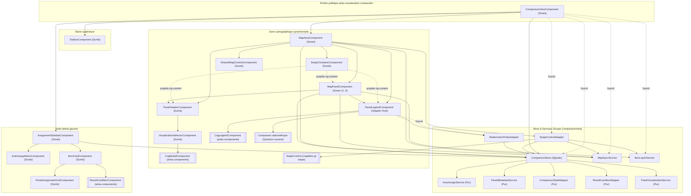

# Spécification technique : Comparaison de visualisations d'imagerie (V1)

> **Référentiel source** : *Spécification fonctionnelle : Comparaison de visualisations d'imagerie (V1)* (`05-spec-comparaison-visu-raster-v1.md` — RF-01 à RF-39, CA-01 à CA-13, parcours 4.1 à 4.5).  
> **Cible d'intégration** : bibliothèque Angular **`ARLAS-web-components`** (npm / `ng-packagr`), **Angular 21** (standalone, `OnPush`, Signals, zoneless-ready), **MapLibre GL JS**, **`maplibre-gl-swipe`**, **TypeScript strict**.

> **Voir aussi** : `01-modele-etat.md` · `02-composants-services.md` · `03-algorithmes.md` · `04-integration-maplibre.md` · `05-tests-tracabilite.md` · `06-questions-ouvertes.md` · `schema/comparison-state.schema.json` · `_TODO-incoherences.md`

---

## Sommaire des fichiers de la spécification technique

| Fichier | Contenu |
|---|---|
| `00-index-adr.md` | Référentiel, sommaire, correspondance des sections, `00 § 1` (ADR) et `00 § 2` (intégration `ARLAS-web-components`, arborescence, `public-api.ts`, architecture Smart/Dumb, diagramme de dépendances) |
| `01-modele-etat.md` | `01 § 4` : modèle de données TypeScript, machine à états du store, contrat sérialisable `ComparisonState`, renvois JSON Schema & exemples, tolérance non bloquante, ordre d'initialisation, invariant de Round-Trip et migration de schéma |
| `02-composants-services.md` | `02 § 3` : spécification des 13 composants Angular (`02 § 3.1`) et des 10 services / adaptateurs / mappers (`02 § 3.2`) |
| `03-algorithmes.md` | `03 § 6` : pseudo-code déterministe (tri et visualisation par défaut, auto-assignations par constellation, par date d'acquisition et globale, maintien/recalcul de visualisation, métadonnées UTC) |
| `04-integration-maplibre.md` | `04 § 5` : instanciation MapLibre sans Globe, synchronisation continue `MapSyncService`, mode Balayage `maplibre-gl-swipe`, couches raster `ItemLayerService`, sonde radiométrique et réutilisation `arlas-components` |
| `05-tests-tracabilite.md` | `05 § 8` (pyramide de tests sans WebGL, doublures `FakeMapLibreMap` / `FakeSwipeControl`, suites normatives) et `05 § 9` (matrices de traçabilité des exigences et critères d'acceptation) |
| `06-questions-ouvertes.md` | `06 § 7` : questions ouvertes et hypothèses d'intégration à arbitrer |
| `schema/comparison-state.schema.json` | JSON Schema Draft 2020-12 de `ComparisonState` (extrait de `01 § 4.4`) |
| `examples/comparison-state-ca13.json` | Exemple JSON 1 de `ComparisonState` (extrait de `01 § 4.4`) |
| `examples/comparison-state-parcours-4-5.json` | Exemple JSON 2 de `ComparisonState` (extrait de `01 § 4.4`) |

## 1. Décisions d'architecture (ADR courts)

### ADR-01 — Gestion d'état locale par Signal Store injectable au niveau racine de la vue
* **Contexte** : La vue de comparaison est plein écran, autonome et agnostique de l'application appelante (RF-01). Elle orchestre de nombreuses dérivations synchrones (groupes par panneau, union et recalcul de visualisations, métadonnées UTC d'en-tête, badges d'incompatibilité/erreur, sérialisation `ComparisonState`) et doit être compatible Angular 21 sans `zone.js`.
* **Décision** : Fournir un service `ComparisonStore` dans le tableau `providers` de `ComparisonViewComponent` (cycle de vie lié à l'ouverture/fermeture de la vue, aucune persistance singleton globale involontaire). L'état primaire est détenu par des `WritableSignal` privés ; toutes les projections métier sont exposées en `Signal` lecture seule via `computed()` et `linkedSignal()`. Aucun recours à NgRx.
* **Conséquences** : Isolation complète entre deux ouvertures successives ; testabilité unitaire sans DOM ; propagation granulaire compatible `ChangeDetectionStrategy.OnPush` et zoneless.

### ADR-02 — Mode Balayage (Swipe) basé sur `maplibre-gl-swipe` (`SwipeControl`) en mode headless
* **Contexte** : Le mode « Balayage » (RF-09, RF-10) compare `P1` (à gauche) et `P2` (à droite) dans un même cadre avec poignée verticale mobile initialisée à 50 %, tout en conservant intégralement les groupes, visualisations, états de chargement/erreur et métadonnées lors du basculement depuis/vers « Côte à côte ».
* **Décision** : Déléguer le découpage cartographique et la poignée interactive à la bibliothèque [`maplibre-gl-swipe`](https://github.com/opengeos/maplibre-gl-swipe) (`SwipeControl`, licence MIT) encapsulée par `SwipeControlAdapter` en mode *headless* (`orientation: 'vertical'`, `showPanel: false`, bouton de contrôle natif masqué). Attaché à la carte `P1` plein cadre, `SwipeControl` instancie en interne une seconde carte MapLibre esclave (`getComparisonMap()`, `interactive: false`, `pointer-events: none`) découpée dans `.swipe-clip-container` avec alignement sur `devicePixelRatio` et cadencement `requestAnimationFrame`.
* **Justification et conséquences d'intégration** :
  1. Réutilisation d'un contrôle MapLibre dédié gérant nativement le glissement souris/tactile à 60 fps, la synchronisation caméra (`jumpTo`) / `resize` entre `P1` et la carte de comparaison, et le passage sans couture des événements pointeur vers `P1`.
  2. Empreinte WebGL maîtrisée à **2 contextes** en mode `swipe` (`P1` + `getComparisonMap()`) : `MapPanelComponent(P2)` est démonté pendant le balayage tandis que l'état logique de `P1` et `P2` dans `ComparisonStore` demeure intégralement préservé lors des transitions `Côte à côte` $\leftrightarrow$ `Balayage` (RF-10), tandis que `SwipeContainerComponent` projette les en-têtes et légendes de `P1` (à gauche) et `P2` (à droite).
  3. Pilotage explicite de `swipeControl.getComparisonMap()` par `ItemLayerService` et `MapSyncService` pour couvrir les opérations non relayées nativement par `maplibre-gl-swipe` : `raster-opacity` dynamique (RF-16), réordonnancement `moveLayer` (RF-06), surbrillance GeoJSON `setData` (RF-28), relief 3D `setTerrain` (RF-13/RF-14), changement de `setStyle` de fond de carte, suivi `sourcedata`/`error` de `P2` (RF-24/RF-25) et accessibilité clavier ARIA de `.swipe-slider-handle`.

### ADR-03 — Séparation stricte entre `ComparisonState` sérialisable et état runtime
* **Contexte** : La V1 exige l'ouverture directe depuis un état préétabli tolérant aux écarts (RF-37, RF-38) et l'export à la demande de l'état courant (RF-39, CA-13), tandis que la bibliothèque de sauvegardes et les permaliens sont reportés en V2 (Spec fonc. § 3.2).
* **Décision** : Définir un contrat de données pur JSON (`ComparisonState`, versionné par `schemaVersion`) exempt de toute référence runtime (instances MapLibre, promesses/requêtes de tuiles, erreurs réseau, coordonnée survolée). La conversion bidirectionnelle et la politique de tolérance RF-38 sont isolées dans `ComparisonStateMapper`.
* **Conséquences** : Sérialisation déterministe testable en round-trip pur, contrat stable prêt pour la V2 (stockage serveur, URL/bookmark ARLAS) sans couplage du composant à un mécanisme de persistance.

### ADR-04 — Découplage de la lecture radiométrique via `RadiometricProbeAdapter` *(en réévaluation — voir question ouverte 06 § 7)*
* **Contexte** : La lecture synchronisée des valeurs radiométriques au survol (RF-21, CA-10, y compris à opacité 0 %) visait initialement la réutilisation directe d'un composant ARLAS existant. Or ce composant est défini dans une **application parente** (et non dans `ARLAS-web-components`, empêchant tout import direct depuis `projects/arlas-visualisation-comparator`) et **ne couvre que les COG** (pas les autres visualisations raster).
* **Orientation conservatoire** : Isoler dans le comparateur la mécanique agnostique — capture de `hoveredLngLat` et résolution géométrique de l'item valide au sommet de la pile par panneau — derrière `RadiometricProbeAdapter`, dans l'attente de l'arbitrage architectural (06 § 7 : injection par l'application parente via contrat/template, rapatriement dans `ARLAS-web-components`, et comportement pour les visualisations non-COG).

### ADR-05 — Alignement natif Angular 21 avec `ARLAS-web-components`
* **Contexte** : `ARLAS-web-components` cible Angular 21. Le module de comparaison exploite nativement les APIs Angular 21 : composants `standalone` implicites, APIs réactives basées sur les signals (`signal`, `computed`, `linkedSignal`, `input()`, `output()`, `model()`), flux de contrôle `@if/@for/@switch`, `inject()` et compatibilité zoneless.
* **Points d'attention d'exécution** :
  * *Interopérabilité Zone.js / Zoneless* : Les callbacks externes hors Angular (événements MapLibre `move`, `mousemove`, `sourcedata`, `error`, `ResizeObserver`, événements `slide` / `slideend` de `SwipeControl`) mettent exclusivement à jour des `WritableSignal`. En Angular 21, l'écriture d'un signal notifie automatiquement le planificateur de rendu aussi bien en application **zoneless** (`provideZonelessChangeDetection()`) qu'en application classique avec `Zone.js` (où les écouteurs MapLibre et `SwipeControl` restent enregistrés dans `NgZone.runOutsideAngular()` pour éviter des cycles CD globaux parasites à 60 Hz).
  * *Exports npm* : Les composants sont `standalone` par défaut en Angular 21. Pour préserver la rétrocompatibilité éventuelle des consommateurs NgModule d'`ARLAS-web-components`, un tableau `COMPARISON_COMPONENTS` (ou module façade léger ré-exportant les composants standalone) peut être exposé dans `public-api.ts`.

### ADR-06 — Réutilisation de `ResultCardItemComponent` (`arlas-components`) par composition verticale à deux étages
* **Contexte** : Le volet latéral gauche (RF-27 à RF-32) présente chaque item sous forme de carte tout en y associant un commutateur `Choix unique / Multi-panneaux`, des badges d'état et `PanelAssignmentGridComponent` (`[P1]..[PN]`, sur 2 lignes en Grille 2x2). Le composant existant `ResultCardItemComponent` (`arlas-result-card-item` dans `projects/arlas-components`) couvre déjà la vignette `100×100 px`, la visionneuse plein écran (`FullScreenViewerService`), le titre, les lignes de métadonnées configurables (`CardField[][]`) et les actions d'item (`ResultActionsComponent`), mais impose `height: 116px` sur `:host`, ne dispose d'aucun `<ng-content>`, affiche en dur une case à cocher de sélection dans `ResultThumbnailComponent`, n'est pas exporté dans `projects/arlas-components/src/public-api.ts` et déclare `detailedDataRetriever` en `protected input.required`.
* **Décision** : Structurer `ItemCardComponent` (`arlas-comparison-item-card`) comme une carte composite verticale à **deux étages** partageant le même conteneur de survol d'emprise (RF-28) :
  1. *Étage supérieur* : `<arlas-result-card-item>` occupant toute la largeur utile du volet pour préserver la lisibilité des métadonnées UTC et de la vignette, alimenté via `ResultCardItemMapper` (ou directement depuis une instance `Item` ARLAS fournie par l'application appelante), avec l'action « Centrer sur l'item » câblée sur `actionOnItemEvent`.
  2. *Étage inférieur* : bandeau d'affectation à hauteur adaptative hébergeant le commutateur `single`/`multi`, les badges d'état (RF-20, RF-25, RF-29) et `PanelAssignmentGridComponent`.
* **Conséquences (prérequis rétrocompatibles dans `projects/arlas-components`)** :
  1. Exporter `ResultCardItemComponent` dans `projects/arlas-components/src/public-api.ts`.
  2. Rendre `public` `activatedActionsPerItem`, `useHttp` et `detailedDataRetriever`, et rendre `detailedDataRetriever` optionnel (`input<DetailedDataRetriever | undefined>(undefined)`).
  3. Ajouter `showSelectionCheckbox = input<boolean>(true)` sur `ResultCardItemComponent` / `ResultThumbnailComponent` (forcé à `false` dans le comparateur pour éviter toute confusion avec les boutons `[P1]..[PN]`).

### ADR-07 — Sélection de visualisation par réutilisation de `CogModalComponent` (`arlas-cog-modal`) et calcul d'union par panneau
* **Contexte** : Chaque panneau actif doit permettre de choisir une visualisation unique parmi l'union de celles supportées par son groupe d'items, tout en signalant lorsqu'une visualisation ne s'applique qu'à une partie des items du panneau (RF-17 à RF-20, CA-09). L'application appelante pré-fournit sur chaque `ComparisonItem` la liste résolue de ses visualisations (`item.visualizations`), tandis que `projects/arlas-components` exporte déjà `CogModalComponent` (`arlas-cog-modal`), `CogPreviewComponent`, `CogLegendComponent`, `CogVisualisationData` et `VisualisationInterface`.
* **Décision** :
  1. Confier à l'application appelante la résolution amont de `item.visualizations` (URLs de tuiles déjà interpolées pour chaque item avec conservation des placeholders MapLibre `{z}`, `{x}`, `{y}`, `{-y}`, `{bbox-epsg-3857}`, ainsi que `previewUrl`, `legendConfig` et `defaultVisualizationId`), gardant `arlas-visualisation-comparator` agnostique des règles catalogue amont (`visualisationsList` / filtres STAC ou ARLAS).
  2. Déléguer à un service pur `PanelVisualizationService` le calcul, pour chaque panneau actif, de l'**union ordonnée** des visualisations disponibles sur les items assignés au panneau et la construction des entrées `CogVisualisationData[]` (`match: 'all' | 'partial'`, `selected: true` sur la visualisation active du panneau, `preview` avec placeholder data-URI de repli pour éviter tout `404` sur `./assets/no-view.png`).
  3. Faire de `VisualizationSelectorComponent` le déclencheur dans `PanelHeaderComponent` ouvrant `CogModalComponent` via `MatDialog`, dont le choix met à jour l'identifiant unique du panneau dans `ComparisonState.panelVisualizations`.
* **Conséquences** : Homogénéité native avec la sélection de visualisations ARLAS (y compris l'alerte native de compatibilité partielle `match: 'partial'` et le support des images protégées via `ProtectImageDirective`) sans dupliquer le moteur d'évaluation de filtres dans le comparateur.

---

## 2. Intégration `ARLAS-web-components`, arborescence et dépendances

### 2.1 Positionnement dans la bibliothèque `ARLAS-web-components`
* **Projet cible dans le monorepo** : Le comparateur constitue une nouvelle bibliothèque Angular dédiée (`"projectType": "library"` dans le workspace `ARLAS-web-components`), située sous le chemin **`projects/arlas-visualisation-comparator/`**.
  * Ce découpage isole naturellement les dépendances spécifiques (`maplibre-gl`, `maplibre-gl-swipe` `^0.14.0`) sans alourdir le bundle des autres projets du monorepo (`projects/arlas-components`, etc.).
  * Il consomme le package npm `arlas-web-components` (dossier `projects/arlas-components` du monorepo `ARLAS-web-components`) en `peerDependency` interne pour réutiliser `ResultCardItemComponent`, `ResultDetailedItemComponent`, `Item`, `CardField`, `Action`, `DetailedDataRetriever`, `ResultListOptions`, ainsi que `CogModalComponent`, `CogVisualisationData`, `CogLegendComponent` et `VisualisationInterface`.
  * *Convention de nommage* : dans ce document, **`ARLAS-web-components`** désigne le monorepo, **`arlas-web-components`** (`projects/arlas-components`) la bibliothèque existante de composants ARLAS, et toute l'API TypeScript propre au comparateur adopte l'orthographe US **`Visualization*`** (seuls les types importés d'`arlas-web-components` comme `CogVisualisationData` et `VisualisationInterface`, ainsi que le nom de dossier `arlas-visualisation-comparator` et la clé `{ visualisations }` attendue par `CogModalComponent`, conservent l'orthographe UK existante).
  * La librairie dispose de son propre fichier `ng-package.json`, son `package.json` et son point d'entrée public `src/public-api.ts`.
* **Préfixe de sélecteurs** : `arlas-comparison-*` (*ou préfixe `arlas-` standard de la lib*).
* **Styles et thèmes** : Variables CSS personnalisées (`--arlas-comparison-*`) encapsulées dans `:host` + import des styles de poignée `maplibre-gl-swipe/style.css` surchargés aux couleurs du thème ARLAS (clair/sombre) sans fuite de style globale (`ViewEncapsulation.Emulated`).

### 2.2 Arborescence cible

```text
projects/arlas-visualisation-comparator/
├── ng-package.json
├── src/
│   ├── public-api.ts                              # Ré-export public (composant racine, types, schema, mapper)
│   └── lib/
│       └── comparison/
│           ├── index.ts
│           ├── models/
│           │   ├── comparison-item.model.ts       # ComparisonItem, VisualizationDescriptor, GeoBoundingBox
│           │   ├── comparison-panel.model.ts      # PanelId, LayoutMode, AssignmentMode, PanelRuntimeState, PanelViewModel
│           │   ├── comparison-camera.model.ts     # LngLatTuple, CameraState, BasemapDescriptor, TerrainDescriptor
│           │   └── comparison-state.model.ts      # ComparisonState (RF-37..39), RuntimeSerializableSnapshot, StateRestoreWarning
│           ├── schema/
│           │   └── comparison-state.schema.json   # JSON Schema 2020-12 de ComparisonState
│           ├── state/
│           │   ├── comparison.store.ts            # ComparisonStore (Signals + transitions déterministes)
│           │   └── comparison.store.spec.ts
│           ├── services/
│           │   ├── auto-assign.service.ts         # AutoAssignService (RF-33..36, fonctions pures)
│           │   ├── auto-assign.service.spec.ts
│           │   ├── panel-metadata.service.ts      # PanelMetadataService (RF-04, RF-22, RF-23, UTC)
│           │   ├── panel-metadata.service.spec.ts
│           │   ├── comparison-state.mapper.ts     # ComparisonStateMapper (import tolérant RF-38, export RF-39, migrations)
│           │   ├── comparison-state.mapper.spec.ts
│           │   ├── result-card-item.mapper.ts     # ResultCardItemMapper (ComparisonItem -> Item ARLAS + CardField UTC + Action Centrer)
│           │   ├── result-card-item.mapper.spec.ts
│           │   ├── panel-visualization.service.ts        # PanelVisualizationService (union par panneau RF-20, CogVisualisationData)
│           │   ├── panel-visualization.service.spec.ts
│           │   ├── map-sync.service.ts            # MapSyncService (caméra, fond, terrain, garde anti-boucle)
│           │   ├── map-sync.service.spec.ts
│           │   ├── item-layer.service.ts          # ItemLayerService (sources/couches raster, ordre RF-06, emprise RF-28)
│           │   ├── item-layer.service.spec.ts
│           │   ├── swipe-control.adapter.ts       # SwipeControlAdapter (intégration headless maplibre-gl-swipe RF-09..10)
│           │   ├── swipe-control.adapter.spec.ts
│           │   ├── radiometric-probe.adapter.ts   # RadiometricProbeAdapter (résolution géométrique & point d'extension sonde — 00 § ADR-04)
│           │   └── radiometric-probe.adapter.spec.ts
│           └── components/
│               ├── comparison-view/               # [SMART] Racine plein écran (RF-01..03, RF-37..39)
│               │   ├── comparison-view.component.ts
│               │   ├── comparison-view.component.html
│               │   ├── comparison-view.component.scss
│               │   └── comparison-view.component.spec.ts
│               ├── toolbar/                       # [DUMB] Barre supérieure : disposition, opacité, Exporter, Fermer
│               │   └── toolbar.component.{ts,html,scss,spec.ts}
│               ├── assignment-sidebar/            # [SMART] Volet latéral escamotable
│               │   └── assignment-sidebar.component.{ts,html,scss,spec.ts}
│               ├── auto-assign-menu/              # [DUMB] Menu déroulant des 3 critères d'auto-assignation
│               │   └── auto-assign-menu.component.{ts,html,scss,spec.ts}
│               ├── item-card/                     # [DUMB] Carte composite 2 étages (arlas-result-card-item + bandeau mode 1/Mul & grille)
│               │   └── item-card.component.{ts,html,scss,spec.ts}
│               ├── panel-assignment-grid/         # [DUMB] Grille miroir [P1]..[PN]
│               │   └── panel-assignment-grid.component.{ts,html,scss,spec.ts}
│               ├── map-area/                      # [SMART] Zone cartographique globale (grille ou balayage + contrôles)
│               │   └── map-area.component.{ts,html,scss,spec.ts}
│               ├── swipe-container/               # [DUMB] Mise en page d'overlays gauche/droite (P1/P2) autour de la carte swipée (RF-09)
│               │   └── swipe-container.component.{ts,html,scss,spec.ts}
│               ├── map-panel/                     # [SMART] Hôte d'une instance MapLibre + en-tête + légende + statut
│               │   └── map-panel.component.{ts,html,scss,spec.ts}
│               ├── panel-header/                  # [DUMB] En-tête de panneau (métadonnées UTC ou état vide)
│               │   └── panel-header.component.{ts,html,scss,spec.ts}
│               ├── visualization-selector/        # [DUMB] Bouton « Changer la visualisation » ouvrant CogModalComponent (arlas-cog-modal)
│               │   └── visualization-selector.component.{ts,html,scss,spec.ts}
│               ├── panel-legend/                  # [SMART-ADAPTER] Légende (CogLegendComponent) & hôte de lecture radiométrique
│               │   └── panel-legend.component.{ts,html,scss,spec.ts}
│               └── shared-map-controls/           # [DUMB] Bloc unique : Zoom +/-, Boussole, Relief 3D/2D, Fond de carte
│                   └── shared-map-controls.component.{ts,html,scss,spec.ts}
└── assets/
    └── i18n/
        ├── fr.json
        └── en.json
```

### 2.3 Surface publique exportée (`public-api.ts`)
Seuls le composant racine, les contrats de données, le schéma JSON et le mapper d'état (utile pour validation amont éventuelle) sont exposés publiquement ; les sous-composants et services internes restent privés au package :

```typescript
export { ComparisonViewComponent } from './lib/comparison/components/comparison-view/comparison-view.component';
export {
  ComparisonItem,
  VisualizationDescriptor,
  GeoBoundingBox
} from './lib/comparison/models/comparison-item.model';
export {
  PanelId,
  LayoutMode,
  AssignmentMode,
  AutoAssignCriterion,
  DEFAULT_AUTO_ASSIGN_CRITERIA
} from './lib/comparison/models/comparison-panel.model';
export {
  LngLatTuple,
  CameraState,
  BasemapDescriptor,
  TerrainDescriptor
} from './lib/comparison/models/comparison-camera.model';
export {
  ComparisonState,
  ComparisonViewState,
  ItemAssignmentState,
  StateRestoreWarning,
  StateRestoreWarningCode,
  COMPARISON_STATE_SCHEMA_VERSION
} from './lib/comparison/models/comparison-state.model';
export { ComparisonStateMapper } from './lib/comparison/services/comparison-state.mapper';
```

### 2.4 Règle d'architecture Smart / Dumb
1. **Composants Smart (Conteneurs — 4 composants + 1 adaptateur)** : `ComparisonViewComponent`, `AssignmentSidebarComponent`, `MapAreaComponent`, `MapPanelComponent`, et `PanelLegendComponent` (pour le câblage de `RadiometricProbeAdapter`). Seuls ces composants sont autorisés à utiliser `inject()` vers `ComparisonStore`, `MapSyncService`, `ItemLayerService`, `SwipeControlAdapter` ou `RadiometricProbeAdapter`.
2. **Composants Dumb (Présentation pure — 8 composants)** : `ToolbarComponent`, `AutoAssignMenuComponent`, `ItemCardComponent`, `PanelAssignmentGridComponent`, `SwipeContainerComponent` (coquille pure de mise en page sans injection de service : c'est son parent Smart `MapAreaComponent` qui instancie et y projette par `<ng-content>` le `MapPanelComponent(P1)` et les overlays de `P2`), `PanelHeaderComponent`, `VisualizationSelectorComponent` (n'injecte que `MatDialog` d'Angular Material pour ouvrir `CogModalComponent` avec ses `input()`), `SharedMapControlsComponent`. Ils ne dépendent d'aucun service d'état métier, communiquent exclusivement par `input()`, `output()` et `model()`, sont en `ChangeDetectionStrategy.OnPush` et se testent isolément sans mock de store.
3. **Services purs sans état (Stateless)** : `AutoAssignService`, `PanelMetadataService`, `ComparisonStateMapper`, `ResultCardItemMapper`, `PanelVisualizationService`. Leurs méthodes sont déterministes, sans effet de bord ni dépendance DOM/WebGL.

### 2.5 Diagramme de dépendances (Mermaid)


