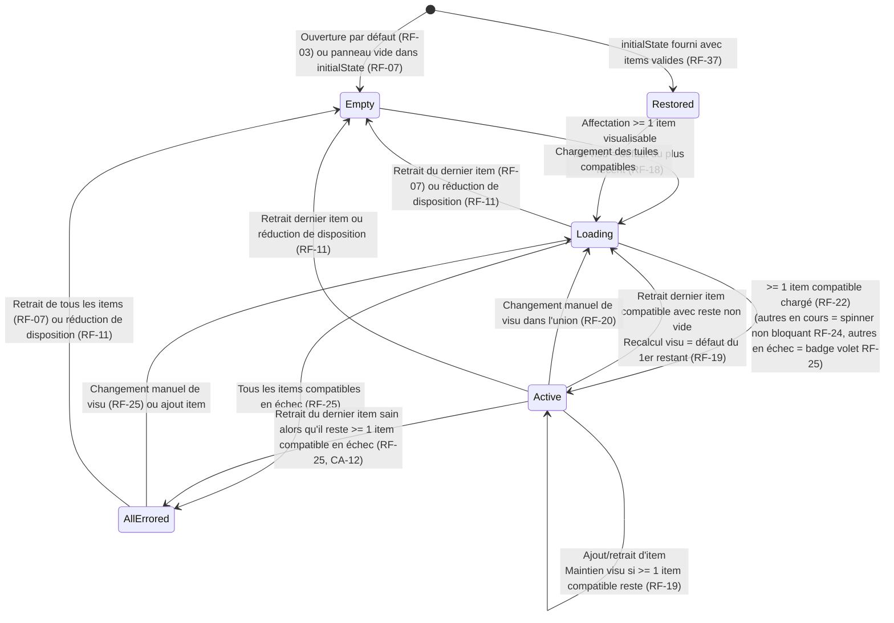

# Spécification technique — Modèle de données, machine à états et `ComparisonState`

> **Référentiel source** : *Spécification fonctionnelle : Comparaison de visualisations d'imagerie (V1)* (`05-spec-comparaison-visu-raster-v1.md`).  
> **Voir aussi** : `00-index-adr.md` · `02-composants-services.md` · `03-algorithmes.md` · `05-tests-tracabilite.md` · `06-questions-ouvertes.md` · `schema/comparison-state.schema.json` · `examples/comparison-state-ca13.json` · `examples/comparison-state-parcours-4-5.json`

---

## 4. Modèle de données, machine à états et `ComparisonState`

### 4.1 Modèle de données métier et runtime (TypeScript strict)

```typescript
/** Boîte englobante WGS84 [west, south, east, north] */
export type GeoBoundingBox = readonly [west: number, south: number, east: number, north: number];

/** Coordonnée géographique [lng, lat] en degrés WGS84 */
export type LngLatTuple = readonly [lng: number, lat: number];

export type PanelId = 'P1' | 'P2' | 'P3' | 'P4';
export const ALL_PANEL_IDS: readonly PanelId[] = ['P1', 'P2', 'P3', 'P4'] as const;

export type LayoutMode = 'side-by-side' | 'swipe' | 'three-columns' | 'grid-2x2';
export type AssignmentMode = 'single' | 'multi';
export type AutoAssignCriterion = 'constellation' | 'acquisition-date' | 'all-in-each';
export const DEFAULT_AUTO_ASSIGN_CRITERIA: readonly AutoAssignCriterion[] = [
  'constellation',
  'acquisition-date',
  'all-in-each'
] as const;
export type LayerLoadStatus = 'idle' | 'loading' | 'loaded' | 'error';

/** Descripteur résolu d'une visualisation pré-fournie sur un ComparisonItem donné (Spec fonc. § 2 « Visualisation ») */
export interface VisualizationDescriptor {
  /** Identifiant logique de la visualisation (partagé entre items supportant la même visualisation) */
  readonly id: string;
  readonly label: string;
  readonly description?: string;
  readonly protocol?: string;
  /** URL de tuiles XYZ/WMTS déjà résolue pour cet item par l'application appelante ({z}/{x}/{y}/{-y}/{bbox-epsg-3857} conservés pour MapLibre) */
  readonly tileUrlTemplate: string;
  /** URL d'aperçu vignette pour CogPreviewComponent dans CogModalComponent */
  readonly previewUrl?: string;
  readonly tileSize?: 256 | 512;
  readonly minZoom?: number;
  readonly maxZoom?: number;
  /** Métadonnées transmises à CogLegendComponent / sonde radiométrique */
  readonly legendConfig?: {
    /** Identifiant de la palette TiTiler extrait de colormap_name (ex. 'viridis', 'plasma') */
    readonly colormapName?: string;
    /** URL de l'image de rampe colorimétrique (dérivée de l'endpoint TiTiler /colorMaps/{colormapName}?format=png ou fournie explicitement) */
    readonly colormapUrl?: string;
    readonly min?: number;
    readonly max?: number;
    readonly unit?: string;
    readonly probeParams?: Readonly<Record<string, unknown>>;
  };
}

/** Donnée élémentaire d'observation de la Terre (Spec fonc. § 2 « Item ») */
export interface ComparisonItem {
  readonly id: string;
  /** Identifiant optionnel de la collection ARLAS/STAC */
  readonly collection?: string;
  /** Emprise géographique exacte (polygone/multipolygone WGS84) pour surbrillance RF-28 et test d'inclusion RF-21 */
  readonly geometry: GeoJSON.Polygon | GeoJSON.MultiPolygon;
  /** Boîte englobante précalculée [west, south, east, north] pour cadrage rapide RF-02 / RF-28 */
  readonly bbox: GeoBoundingBox;
  /** Date/heure d'acquisition ISO-8601 UTC (ex: '2026-08-30T10:15:00Z') */
  readonly acquisitionDateIso: string;
  /** Timestamp epoch UTC en millisecondes (dérivé ou fourni à l'entrée pour tri rapide) */
  readonly acquisitionEpochMs: number;
  readonly constellation: string;
  readonly sensor?: string;
  /** Couverture nuageuse en % [0..100], optionnelle pour capteurs radar (ex: Sentinel-1) */
  readonly cloudCover?: number;
  readonly thumbnailUrl?: string;
  /**
   * Instance d'Item ARLAS optionnelle préconstruite par l'application appelante (ResultList)
   * avec ses CardField[][] et actions métier propres à la collection ; non sérialisée dans ComparisonState.
   */
  readonly arlasItem?: Item;
  /** Visualisations pré-fournies par l'application appelante pour cet item ([] si aucune — RF-29) */
  readonly visualizations: readonly VisualizationDescriptor[];
  /** Identifiant de la visualisation par défaut de cet item (RF-18) ; repli sur visualizations[0]?.id */
  readonly defaultVisualizationId?: string;
}

/** Modèle de vue alimentant chaque ItemCardComponent composite dans le volet latéral */
export interface ItemCardViewModel {
  readonly item: ComparisonItem;
  readonly arlasRowItem: Item;
  readonly idFieldName: string;
  readonly isVisualizable: boolean;
  readonly mode: AssignmentMode;
  readonly assignedPanels: readonly PanelId[];
  readonly incompatiblePanels: readonly PanelId[];
  readonly erroredPanels: readonly PanelId[];
}

/** Groupe d'items d'un panneau (Spec fonc. § 2 « Groupe ») */
export interface PanelGroup {
  readonly panelId: PanelId;
  /** Identifiants des items assignés au panneau */
  readonly assignedItemIds: readonly string[];
}

/** État runtime complet d'un panneau (non sérialisé tel quel) */
export interface PanelRuntimeState {
  readonly id: PanelId;
  readonly group: PanelGroup;
  readonly activeVisualizationId: string | null;
  /** Statut réseau par itemId assigné et compatible */
  readonly itemStatuses: Readonly<Record<string, LayerLoadStatus>>;
  readonly itemErrors: Readonly<Record<string, string>>;
}

/** Métadonnées calculées pour l'en-tête d'un panneau actif (RF-22, RF-23) */
export interface PanelHeaderMetadata {
  readonly constellationsLabel: string;
  readonly activeVisualizationLabel: string;
  /** Format strict 'JJ/MM/AAAA HH:mm UTC' */
  readonly meanDateUtcLabel: string;
  /** Format 'Du JJ/MM/AAAA HH:mm au JJ/MM/AAAA HH:mm UTC', ou null si 1 item ou minutes identiques (RF-23) */
  readonly temporalExtentUtcLabel: string | null;
}

export type PanelHeaderState = 'empty' | 'loading-initial' | 'active' | 'all-errored';

/** Modèle de vue complet exposé par ComparisonStore.panelsVm pour chaque panneau P1..P4 */
export interface PanelViewModel {
  readonly id: PanelId;
  readonly headerState: PanelHeaderState;
  readonly isLoading: boolean;
  readonly allErroredMessage: string | null;
  readonly activeVisualization: VisualizationDescriptor | undefined;
  readonly modalVisualizations: readonly CogVisualisationData[];
  readonly metadata: PanelHeaderMetadata | undefined;
  readonly compatibleItemsBottomUp: readonly ComparisonItem[];
  readonly renderedItemsTopDown: readonly ComparisonItem[];
}

/** Paramètres de caméra synchronisée */
export interface CameraState {
  readonly center: LngLatTuple;
  readonly zoom: number;
  readonly bearing: number;
  readonly pitch: number;
}

/** Descripteur d'un fond de carte disponible dans SharedMapControlsComponent */
export interface BasemapDescriptor {
  readonly id: string;
  readonly label: string;
  /** URL vers un fichier style.json MapLibre ou spécification de style en mémoire */
  readonly style: string | maplibregl.StyleSpecification;
  readonly thumbnailUrl?: string;
  readonly isDefault?: boolean;
}

/** Configuration optionnelle d'une source MNT (raster-dem) pour la bascule Relief 3D / Vue 2D (RF-13, RF-14) */
export interface TerrainDescriptor {
  /** URL TileJSON de la source raster-dem (exclusif ou complémentaire de tiles) */
  readonly url?: string;
  /** Templates d'URLs de tuiles DEM XYZ */
  readonly tiles?: readonly string[];
  readonly encoding?: 'mapbox' | 'terrarium';
  readonly tileSize?: 256 | 512;
  readonly minzoom?: number;
  readonly maxzoom?: number;
  /** Facteur d'exagération verticale (défaut: 1) */
  readonly exaggeration?: number;
}

/** Snapshot interne sérialisable transmis par ComparisonStore à ComparisonStateMapper.toExternalState() */
export interface RuntimeSerializableSnapshot {
  readonly layout: LayoutMode;
  readonly swipePosition: number;
  readonly globalOpacity: number;
  readonly sidebarOpen: boolean;
  readonly orderedSidebarItemIds: readonly string[];
  readonly visualizableItemIds: ReadonlySet<string>;
  readonly itemModes: Readonly<Record<string, AssignmentMode>>;
  readonly panelAssignments: Readonly<Record<PanelId, readonly string[]>>;
  readonly activePanelIds: readonly PanelId[];
  readonly panelVisualizations: Readonly<Record<PanelId, string | null>>;
  readonly camera: CameraState | null;
  readonly terrainEnabled: boolean;
  readonly activeBasemapId: string;
}
```

### 4.2 Règles de transition et machine à états du `ComparisonStore`



#### Synthèse des règles déterministes gérées en `computed` et dans les transitions du store :
1. **Nombre de panneaux par disposition (`LAYOUT_PANEL_COUNT`)** :
   * `'side-by-side'` $\rightarrow$ `['P1', 'P2']`
   * `'swipe'` $\rightarrow$ `['P1', 'P2']`
   * `'three-columns'` $\rightarrow$ `['P1', 'P2', 'P3']`
   * `'grid-2x2'` $\rightarrow$ `['P1', 'P2', 'P3', 'P4']`
2. **Transition de disposition (`setLayout`)** :
   * `side-by-side` $\leftrightarrow$ `swipe` : aucune modification de `P1`/`P2` ni de leurs visualisations (RF-10) ; `swipePosition` initialisé à `50` si non encore défini (RF-09).
   * Réduction ($N_{\text{new}} < N_{\text{old}}$, RF-11) : pour chaque panneau retiré $P_k$ ($k > N_{\text{new}}$), `assignedItemIds[Pk] = []`, `activeVisualizationId[Pk] = null`, `itemStatuses[Pk] = {}`. Les items ne conservent aucun état caché sur $P_k$.
   * Extension ($N_{\text{new}} > N_{\text{old}}$, RF-12) : `P1..P_{N_old}` et leurs visualisations restent intacts ; les nouveaux panneaux s'ouvrent à l'état vide ; aucune auto-assignation n'est déclenchée.
3. **Affectation / Retrait (`toggleItemPanelAssignment`)** :
   * Ignoré si `item.visualizations.length === 0` (RF-29).
   * En mode `'single'` (RF-30) :
     * Si `panelId` est déjà le panneau sélectionné de l'item $\rightarrow$ désélectionne `panelId` (retrait unitaire au clic).
     * Sinon $\rightarrow$ retire l'item de son éventuel panneau précédent $P_{\text{old}}$ (avec recalcul RF-19 sur $P_{\text{old}}$) et l'ajoute à `panelId` (avec initialisation RF-18 si `panelId` était vide).
   * En mode `'multi'` (RF-30) : bascule l'appartenance de `itemId` dans `panelId` uniquement.
4. **Repli `multi` $\rightarrow$ `single` (`setItemAssignmentMode`, RF-31)** :
   * Si l'item est actuellement assigné à un sous-ensemble $S \subseteq \{P1, P2, P3, P4\}$ avec $|S| > 1$, trier $S$ dans l'ordre canonique `['P1', 'P2', 'P3', 'P4']`, conserver `S[0]` uniquement et retirer l'item de `S.slice(1)` (en appliquant le recalcul RF-19 sur chacun des panneaux quittés).
5. **Graphe des signaux dérivés (`computed` / `linkedSignal`)** :
   * `sortedItems = computed(...)` : tri global `(acquisitionEpochMs DESC, id ASC)` (RF-27).
   * `panelAssignedItems[Pn] = computed(...)` : sous-liste de `sortedItems` affectée à `Pn` (conserve l'ordre du plus récent au plus ancien).
   * `panelUnionVisualizations[Pn] = computed(...)` : union ordonnée des `VisualizationDescriptor` (parcours de `panelAssignedItems[Pn]` du plus récent au plus ancien, déduplication par `id` — RF-20).
   * `panelCompatibleItems[Pn] = computed(...)` : sous-liste de `panelAssignedItems[Pn]` supportant `activeVisualizationId[Pn]` (RF-20).
   * `panelIncompatibleItemIds[Pn] = computed(...)` : items assignés à `Pn` ne supportant pas `activeVisualizationId[Pn]` $\rightarrow$ badge d'avertissement dans `ItemCardComponent` (RF-20).
   * `panelStackBottomUp[Pn] = computed(...)` : `panelCompatibleItems[Pn]` inversé (du plus ancien en dessous au plus récent au sommet, RF-06).
   * `panelRenderedItems[Pn] = computed(...)` : items de `panelCompatibleItems[Pn]` effectivement chargés (`status === 'loaded'`, hors `'error'` — voir machine à états 01 § 4.2).
   * `panelActiveVisualization[Pn] = computed(...)` : descripteur unique représentant le choix de visualisation actif du panneau (pour l'en-tête et la légende), résolu comme `item.visualizations.find(v => v.id === activeVisualizationId[Pn])` sur le premier item rendu (`panelRenderedItems[Pn][0]`, au sommet de la pile), avec repli pendant `'loading-initial'` ou `'all-errored'` sur `panelCompatibleItems[Pn][0]`.
   * `panelHeaderMetadata[Pn] = computed(...)` : appel à `PanelMetadataService.computeHeaderMetadata` sur `panelRenderedItems[Pn]` et `panelActiveVisualization[Pn]` (RF-22, RF-23).
   * `swipePosition = linkedSignal(...)` : conserve la position courante tant que la session dure, initialisée à `50` par défaut ou depuis `initialState.swipePosition`.

---

### 4.3 Contrat sérialisable `ComparisonState` (RF-37, RF-38, RF-39, CA-13)

Tous les champs de `ComparisonState` sont **optionnels** afin de satisfaire RF-38 (*« tout paramètre non renseigné adopte sa valeur par défaut »*). Aucune donnée runtime (instances MapLibre, chargements, erreurs, coordonnée de survol) n'y figure. Les items sont référencés exclusivement par leur identifiant `string`.

```typescript
export const COMPARISON_STATE_SCHEMA_VERSION = 1 as const;

export interface ItemAssignmentState {
  /** Mode d'affectation de l'item ; défaut 'single' (RF-30) */
  readonly mode?: AssignmentMode;
  /** Panneaux auxquels cet item est affecté, ex: ['P1'] ou ['P1', 'P2'] */
  readonly panels?: readonly PanelId[];
}

export interface ComparisonViewState {
  /** Longitude/Latitude du centre [-180..180, -90..90] */
  readonly center?: readonly [lng: number, lat: number];
  /** Niveau de zoom MapLibre [0..24] */
  readonly zoom?: number;
  /** Orientation en degrés [-180..180], défaut 0 (Nord en haut) */
  readonly bearing?: number;
  /** Inclinaison en degrés [0..85], défaut 0 */
  readonly pitch?: number;
  /** Activation du relief 3D (défaut: false) */
  readonly terrain3d?: boolean;
  /** Identifiant du fond de carte actif */
  readonly basemapId?: string;
}

/**
 * État de comparaison sérialisable (V1) — Contrat d'entrée initialState et de sortie stateExported.
 */
export interface ComparisonState {
  /** Version du schéma de sérialisation (défaut: 1) */
  readonly schemaVersion?: number;
  /** Disposition active (défaut: 'side-by-side') */
  readonly layout?: LayoutMode;
  /** Position de la poignée verticale en mode 'swipe', en % [0..100] (défaut: 50) */
  readonly swipePosition?: number;
  /** Opacité globale des visualisations en % [0..100] (défaut: 100) */
  readonly globalOpacity?: number;
  /** État déployé (true) ou rétracté (false) du volet latéral gauche (défaut: true) */
  readonly sidebarOpen?: boolean;
  /**
   * Liste exhaustive des identifiants des items présents dans le volet latéral gauche lors de la session.
   * Permet à l'application appelante de requêter et recharger ces items depuis son catalogue ARLAS/STAC
   * avant d'instancier la vue de comparaison (RF-27, RF-37, RF-39 — voir question ouverte 06 § 7 Q6 pour le cas d'un accès direct par route Angular).
   */
  readonly itemIds?: readonly string[];
  /** Affectations et modes d'affectation indexés par identifiant d'item */
  readonly itemAssignments?: Readonly<Record<string, ItemAssignmentState>>;
  /** Identifiant de la visualisation active par panneau ('P1'..'P4') */
  readonly panelVisualizations?: Readonly<Partial<Record<PanelId, string | null>>>;
  /** Paramètres de la vue cartographique synchronisée */
  readonly view?: ComparisonViewState;
}

export type StateRestoreWarningCode =
  | 'INVALID_STATE_ROOT_FALLBACK'
  | 'UNSUPPORTED_SCHEMA_VERSION'
  | 'MIGRATED_SCHEMA_VERSION'
  | 'INVALID_LAYOUT_FALLBACK'
  | 'OUT_OF_RANGE_CLAMPED'
  | 'UNKNOWN_ITEM_IGNORED'
  | 'UNVISUALIZABLE_ITEM_IGNORED'
  | 'INACTIVE_PANEL_ASSIGNMENT_DROPPED'
  | 'SINGLE_MODE_MULTIPLE_PANELS_TRIMMED'
  | 'INCOMPATIBLE_PANEL_VISUALIZATION_FALLBACK'
  | 'INVALID_CAMERA_FALLBACK_AUTO_FIT'
  | 'UNKNOWN_BASEMAP_FALLBACK'
  | 'TERRAIN_UNAVAILABLE_IGNORED';

export interface StateRestoreWarning {
  readonly code: StateRestoreWarningCode;
  readonly path: string;
  readonly message: string;
}
```

### 4.4 JSON Schema (Draft 2020-12)

Schéma : `schema/comparison-state.schema.json`

#### Exemple JSON 1 — Critère d'acceptation CA-13 (3 colonnes, `P1` et `P2` peuplés, `P3` vide, opacité 65 %)

Exemple : `examples/comparison-state-ca13.json`

#### Exemple JSON 2 — Spec fonc. § 4.5 Parcours alternatif (Grille 2x2, `P1`–`P3` peuplés, `P4` vide, opacité 70 %, relief 3D)

Exemple : `examples/comparison-state-parcours-4-5.json`

### 4.5 Politique de tolérance non bloquante (RF-38)

En aucun cas un `initialState` mal formé, obsolète ou incohérent avec les `items` fournis ne doit lever d'exception non interceptée ni bloquer l'ouverture de la vue. Chaque repli produit une entrée `StateRestoreWarning` émise sur `stateRestoreWarnings`.

| Cas dégradé détecté à l'ouverture | Règle explicite appliquée | Code `StateRestoreWarning` |
|---|---|---|
| `initialState === undefined` | État par défaut complet (RF-02, RF-03) : `side-by-side`, panneaux vides, opacité `100`, `sidebarOpen: true`, auto-cadrage sur l'emprise englobante | *(Aucun warning)* |
| Objet racine non-objet JSON (`null`, primitif, tableau) | Repli intégral sur l'état par défaut | `INVALID_STATE_ROOT_FALLBACK` |
| `schemaVersion` absent | Traité comme `schemaVersion = 1` (01 § 4.8) | *(Aucun warning)* |
| `1 <= schemaVersion < CURRENT_VERSION` | Exécution séquentielle des migrations incrémentales (01 § 4.8) | `MIGRATED_SCHEMA_VERSION` |
| `schemaVersion > CURRENT_VERSION`, non entier ou `< 1` | Extraction *best-effort* des propriétés reconnues du schéma courant (01 § 4.8) | `UNSUPPORTED_SCHEMA_VERSION` |
| `layout` inconnu ou hors enum (ex. `'1-panel'`, `'grid-3x3'`) | Repli sur `'side-by-side'` | `INVALID_LAYOUT_FALLBACK` |
| `globalOpacity` non numérique ou hors `[0, 100]` | Si numérique : `clamp(Math.round(val), 0, 100)` ; sinon défaut `100` | `OUT_OF_RANGE_CLAMPED` |
| `swipePosition` non numérique ou hors `[0, 100]` | Si numérique : `clamp(val, 0, 100)` ; sinon défaut `50` | `OUT_OF_RANGE_CLAMPED` |
| `initialState.itemIds` absent, vide (`[]`) ou non-tableau | Le volet latéral intègre l'ensemble des `items()` fournis par l'appelant (RF-27) | *(Aucun warning)* |
| Identifiant listé dans `itemIds` mais absent de `items()` | Identifiant ignoré pour le volet et les affectations + trace d'avertissement (RF-38) | `UNKNOWN_ITEM_IGNORED` |
| Clé `itemId` dans `itemAssignments` absente de `items()` ou exclue par `itemIds` | Entrée ignorée pour le rendu + trace d'avertissement (RF-38) | `UNKNOWN_ITEM_IGNORED` |
| `itemId` présent mais `item.visualizations.length === 0` | Affectation ignorée ; l'item apparaît désactivé dans le volet (RF-29, RF-38) | `UNVISUALIZABLE_ITEM_IGNORED` |
| Panneau invalide (`'P5'`) ou hors de la disposition active (ex. `'P3'` avec `layout: 'side-by-side'`) | Retrait de ce panneau de la liste `panels` de l'item | `INACTIVE_PANEL_ASSIGNMENT_DROPPED` |
| `mode: 'single'` accompagné de $\ge 2$ panneaux valides `['P2', 'P3']` | Application de RF-31 : conservation du premier panneau dans l'ordre `P1..P4` (`'P2'`) | `SINGLE_MODE_MULTIPLE_PANELS_TRIMMED` |
| `panelVisualizations[Pn]` absent, `null` ou supporté par **aucun** item retenu dans `Pn` (panneau non vide) | Repli sur la visualisation par défaut du premier item (le plus récent) de `Pn`, ou sa 1re visualisation (RF-38) | `INCOMPATIBLE_PANEL_VISUALIZATION_FALLBACK` |
| `panelVisualizations[Pn]` renseigné alors que `Pn` est vide après filtrage des items | Forcé à `null` (`Pn` s'affiche à l'état vide RF-07) | `INCOMPATIBLE_PANEL_VISUALIZATION_FALLBACK` |
| `view.center` ou `view.zoom` absent ou hors bornes (`lng` $\notin [-180,180]$, `lat` $\notin [-90,90]$, `zoom` $\notin [0,24]$) | Abandon du cadrage partiel invalide et déclenchement de l'auto-cadrage RF-02 sur l'emprise englobante des `items` | `INVALID_CAMERA_FALLBACK_AUTO_FIT` |
| `view.pitch` non fini / $\notin [0, 85]$ ou `view.bearing` non fini / $\notin [-180, 180]$ | Clamp `pitch` sur `[0, 85]` (défaut `0` si non fini), normalisation modulaire de `bearing` sur `(-180, 180]` (défaut `0` si non fini) | `OUT_OF_RANGE_CLAMPED` |
| `view.basemapId` inconnu dans `basemaps()` | Repli sur le fond de carte par défaut de `basemaps()` | `UNKNOWN_BASEMAP_FALLBACK` |
| `view.terrain3d === true` mais `terrainConfig() === undefined` | Forcé à `false` | `TERRAIN_UNAVAILABLE_IGNORED` |

### 4.6 Ordre d'application déterministe à l'initialisation
L'initialisation (ou la restauration d'état) dans `ComparisonStore.initialize()` s'exécute en une transaction atomique (sans déclencher les recalculs incrémentaux RF-18/RF-19 lors de l'ajout unitaire des items ni aucune auto-assignation) dans l'ordre strict suivant :
1. **Disposition & Balayage** : résolution de `layout` (défaut `'side-by-side'`) $\rightarrow$ détermination de `activePanelIds`, puis résolution de `swipePosition` (défaut `50`).
2. **Items du volet & Affectations** :
   * *Résolution du volet latéral gauche* : Si `initialState.itemIds` est fourni et non vide, la liste des items disponibles dans le volet est restreinte à `items().filter(item => itemIds.includes(item.id))` ; tout identifiant de `itemIds` absent de `items()` émet `UNKNOWN_ITEM_IGNORED`. Si `initialState.itemIds` est absent ou vide, l'intégralité de `items()` est retenue dans le volet. Les items retenus sont ordonnés par `(acquisitionEpochMs DESC, id ASC)` (RF-27).
   * *Initialisation des affectations* : Pour chaque item retenu dans le volet, initialisation à `{ mode: 'single', panels: [] }` ; pour chaque item visualisable présent dans `initialState.itemAssignments` (et appartenant aux items retenus), filtrage des panneaux sur `activePanelIds`, déduplication dans l'ordre `P1..P4` et application du repli RF-31 si `mode === 'single'`.
3. **Visualisations des panneaux** : pour chaque $P_n \in \text{activePanelIds}$ :
   * si `assigned[Pn]` est vide $\rightarrow$ `activeVisualizationId[Pn] = null` ;
   * sinon, si `initialState.panelVisualizations?.[Pn]` est défini et supporté par **au moins un** item de `assigned[Pn]` $\rightarrow$ application directe de cette visualisation ;
   * sinon $\rightarrow$ repli sur la visualisation par défaut du premier item (le plus récent) de `assigned[Pn]` conformément à RF-38.
4. **Vue cartographique synchronisée** : résolution de `basemapId` et `terrainEnabled` ; si `initialState.view?.center` et `initialState.view?.zoom` sont tous deux valides, enregistrement du `CameraState` exact (désactivant l'auto-cadrage RF-02) ; sinon marquage `pendingInitialFitBounds = computeEnvelope(items)` (RF-02).
5. **Opacité globale** : application de `globalOpacity` (défaut `100`).
6. **Volet latéral** : application de `sidebarOpen` (défaut `true`).

### 4.7 Invariant de Round-Trip et normalisation d'export
Lors de `exportCurrentState()` (RF-39) :
* `schemaVersion` vaut `1`.
* `swipePosition` est toujours exporté (permettant de conserver la position si `layout === 'swipe'`, ou `50` par défaut).
* `itemIds` exporte systématiquement la liste ordonnée des identifiants de **l'ensemble des items présents dans le volet latéral gauche** (`sortedItems().map(i => i.id)`), qu'ils soient affectés à un panneau ou libres, permettant à l'application appelante de requêter exactement ces items lors d'une réouverture.
* `itemAssignments` contient une entrée `{ mode, panels }` triée dans l'ordre `P1..P4` pour chaque item visualisable du volet dont `panels.length > 0 || mode !== 'single'`, omise sinon (puisque le défaut à l'import est `{ mode: 'single', panels: [] }`).
* `panelVisualizations` exporte les clés des panneaux actifs (`P1..PN`) avec l'ID de visualisation active ou `null` si vide.
* **Propriété d'idempotence (Round-Trip)** : Pour tout état valide arbitraire $S_0$ et jeu d'items $I$, en posant $S_1 = \text{export}(\text{import}(S_0, I))$ et $S_2 = \text{export}(\text{import}(S_1, I))$, on garantit l'égalité profonde stricte `deepEqual(S_1, S_2)` (avec tolérance flottante $\le 10^{-6}$ sur `center`/`zoom`/`bearing`/`pitch`). Si $S_0$ était déjà canonique et cohérent avec $I$, alors `deepEqual(S_0, S_1)`.

### 4.8 Stratégie minimale de migration de `schemaVersion`
`ComparisonStateMapper` embarque une table ordonnée de fonctions pures de migration incrémentale :
```typescript
type StateMigrator = (raw: Record<string, unknown>) => Record<string, unknown>;

const MIGRATORS: Readonly<Record<number, StateMigrator>> = {
  // Exemple futur V2 : 1: (v1) => ({ ...v1, schemaVersion: 2, ... })
};
```
* Si `schemaVersion` est absent : traité comme `schemaVersion = 1` sans warning.
* Si `1 <= schemaVersion < CURRENT_VERSION` : exécution séquentielle `MIGRATORS[v]` de `v = schemaVersion` jusqu'à `CURRENT_VERSION - 1`, accompagnée d'un warning informatif `MIGRATED_SCHEMA_VERSION`.
* Si `schemaVersion > CURRENT_VERSION` (état produit par une version future plus récente) : émission de `UNSUPPORTED_SCHEMA_VERSION`, extraction *best-effort* des propriétés reconnues du schéma courant en ignorant les propriétés inconnues au lieu d'échouer.
