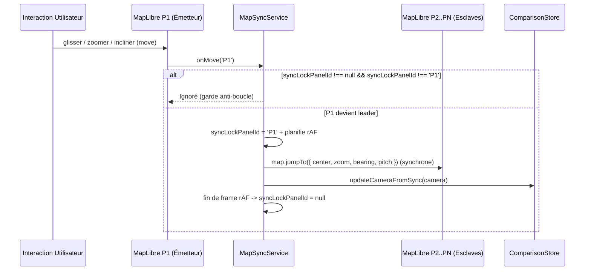

# Spécification technique — Intégration MapLibre GL JS, composants ARLAS et sonde radiométrique

> **Référentiel source** : *Spécification fonctionnelle : Comparaison de visualisations d'imagerie (V1)* (`05-spec-comparaison-visu-raster-v1.md`).  
> **Voir aussi** : `00-index-adr.md` · `01-modele-etat.md` · `02-composants-services.md` · `05-tests-tracabilite.md` · `06-questions-ouvertes.md`

---

## 5. Intégration MapLibre GL JS, composants ARLAS et sonde radiométrique

### 5.1 Instanciation MapLibre et exclusion formelle du mode Globe (RF-15)
Que l'instance cartographique soit fournie par `ARLAS-maplibre` ou par un wrapper `maplibregl.Map` dédié (question ouverte 06 § 7), chaque `MapPanelComponent` configure la carte sous-jacente avec :
* `attributionControl: false` sur les panneaux secondaires (ou attribution compacte mutualisée),
* aucun contrôle natif MapLibre ajouté (`NavigationControl`, `GlobeControl`, `TerrainControl` tous omis, au profit de `SharedMapControlsComponent` — RF-14),
* projection verrouillée en Web Mercator plane (`map.setProjection({ type: 'mercator' })` appliqué systématiquement sur chaque événement `style.load`, garantissant RF-15 même si un fichier de style externe déclare `"projection": { "type": "globe" }`),
* initialisation immédiate avec les paramètres courants `center`, `zoom`, `bearing`, `pitch` du `ComparisonStore` afin d'éviter tout flash sur `[0, 0]` lors de l'ajout d'un 3e ou 4e panneau (RF-12) ou à l'ouverture avec `initialState` (RF-37).

### 5.2 Synchronisation continue et garde anti-boucle (`MapSyncService`)



* **Garde anti-boucle** : Un champ privé `syncLockPanelId: PanelId | null = null` empêche les événements `move` provoqués par `slaveMap.jumpTo(...)` de re-déclencher une propagation inverse.
* **Fluidité 60 fps (`jumpTo` vs `easeTo`)** :
  * Lors d'un déplacement interactif continu (`move` souris/tactile/molette sur un panneau $P_i$), le panneau $P_i$ anime nativement sa propre caméra, et tous les panneaux $P_{j \neq i}$ reçoivent un **`jumpTo`** synchrone (aucune inertie empilée ni décalage de phase entre panneaux), cadencé au plus une fois par frame d'affichage (`requestAnimationFrame`), suivi d'une synchronisation finale sur `moveend`.
  * Lors d'une action discrète issue de `SharedMapControlsComponent` (`Zoom +`, `Zoom -`, `Boussole`, `Centrer sur l'item`), `MapSyncService` désigne `P1` comme pilote d'animation (`easeTo` ou `fitBounds` d'une durée de `250 ms`, ou `0 ms` si `prefers-reduced-motion: reduce`), et la boucle `move` répercute chaque frame sur `P2..PN` via `jumpTo`.
* **Synchronisation du fond de carte et du relief 3D** :
  * Lors d'un changement de fond de carte (`applyBasemapToAll`), MapLibre réinitialisant les sources/couches custom à l'appel de `map.setStyle(...)` (sauf usage de `diff: true` ou reconstruction sur `style.load`), `MapPanelComponent` écoute `style.load` pour forcer `map.setProjection({ type: 'mercator' })`, restaurer le `terrain` 3D s'il est actif, et rejouer `ItemLayerService.syncPanelRasterStack(...)` + `updateHighlightedFootprint(...)`. En mode `swipe`, `SwipeControlAdapter.handleBasemapStyleReload(...)` remonte proprement `SwipeControl` une fois le nouveau style de `P1` chargé afin de recréer `_comparisonMap` sur ce même fond de carte.

### 5.3 Mode Balayage via `maplibre-gl-swipe` (Swipe — RF-09, RF-10)
* **Montage headless de `SwipeControl` sur `P1` (via `SWIPE_CONTROL_FACTORY`, cf. 05 § 8.2)** :
  ```typescript
  // Dans SwipeControlAdapter : private readonly createSwipeControl = inject(SWIPE_CONTROL_FACTORY);
  // Styles importés : 'maplibre-gl-swipe/style.css'

  const swipeControl = this.createSwipeControl({
    orientation: 'vertical',
    position: store.swipePosition(), // 50 par défaut ou restauré depuis initialState (RF-09, RF-37)
    showPanel: false,                // Désactive le panneau natif de sélection de couches
    mousemove: false,                // Déplacement uniquement au drag poignée / clavier
    active: true,
    basemapLayerIds: initialBasemapLayerIds,
    leftLayers: ['__basemap__', ...p1LayerIds, 'arlas-cmp-footprint-highlight'],
    rightLayers: ['__basemap__', ...p2LayerIds, 'arlas-cmp-footprint-highlight'],
    className: 'arlas-comparison-swipe-ctrl-hidden' // display: none sur le bouton maplibregl-ctrl
  });
  hostMapP1.addControl(swipeControl, 'top-right');
  ```
* **Synchronisation de la position** : L'écouteur `swipeControl.on('slide', (e) => store.setSwipePosition(e.position ?? 50))` (exécuté hors `NgZone` si présent) met à jour `ComparisonStore.swipePosition` pour l'export d'état (RF-39) et la persistance de session. Inversement, toute mise à jour externe appelle `swipeControl.setPosition(pct)`.
* **Gestion du fond de carte et des piles `P1` / `P2` sur `getComparisonMap()`** :
  * `_updateLayerVisibility()` de `maplibre-gl-swipe` masquant (`visibility: 'none'`) sur `_comparisonMap` toute couche absente de `rightLayers`, le passage de `basemapLayerIds` et l'inclusion systématique de `'__basemap__'` dans `leftLayers` et `rightLayers` garantissent l'affichage permanent du fond de carte des deux côtés, y compris lorsque `P1` ou `P2` est vide (RF-07) ou à opacité `< 100 %` (RF-16).
  * Les identifiants de sources et couches raster étant préfixés par `panelId` (`arlas-cmp-P1-...` vs `arlas-cmp-P2-...`), un même item affecté simultanément à `P1` et `P2` avec deux visualisations différentes — voire identiques — possède deux couches distinctes sans collision (Spec fonc. § 4.2 Parcours alternatif).
  * Dès que `swipeControl.getComparisonMap()` est prête (`load`), `SwipeControlAdapter` l'enregistre auprès de `MapSyncService.setSwipeComparisonMap(...)` (verrouillage `comparisonMap.setProjection({ type: 'mercator' })` RF-15 + synchronisation `setTerrain` RF-13) et délègue à `ItemLayerService` la maintenance directe sur `comparisonMap` des couches `arlas-cmp-P2-*` (ordre `moveLayer` RF-06, `raster-opacity` RF-16, écoute `sourcedata`/`error` RF-24/RF-25) ainsi que `updateHighlightedFootprint` (RF-28), avant d'appeler `swipeControl.setLeftLayers(...)` et `swipeControl.setRightLayers(...)`.
* **Interactions pointeur et lecture radiométrique (RF-21)** : Dans `maplibre-gl-swipe`, `.swipe-clip-container` et `.swipe-comparison-map` sont définis avec `pointer-events: none` et `interactive: false`. La carte hôte `P1` capte donc de manière continue 100 % des interactions de navigation et des événements `mousemove` sur tout le cadre (à gauche comme à droite de la poignée) et alimente `ComparisonStore.hoveredLngLat` pour les deux `PanelLegendComponent` (`P1` et `P2`).
* **Ancrage des en-têtes et légendes (RF-09)** : `SwipeContainerComponent` projette `PanelHeaderComponent` et `PanelLegendComponent` de `P1` (haut-gauche / bas-gauche, `max-width: 48 %`) et ceux de `P2` (haut-droite / bas-droite, `max-width: 48 %`) dans un overlay situé au-dessus de `.swipe-clip-container` (`z-index > 1`) mais sous `.swipe-slider`, évitant toute troncature lorsque la poignée approche les bords.
* **Accessibilité clavier de la poignée** : `SwipeControl` n'écoutant nativement que `mousedown`/`touchstart` sur `.swipe-slider-handle`, `SwipeControlAdapter` ajoute sur cet élément `tabindex="0"`, `role="slider"`, `aria-orientation="horizontal"` (déplacement gauche $\leftrightarrow$ droite de `0 %` à `100 %`, bien que la ligne de séparation soit verticale), `aria-valuemin="0"`, `aria-valuemax="100"`, `aria-valuenow` dynamique, et un écouteur `keydown` (`ArrowLeft`/`ArrowRight` $\pm 1\%$, `Shift+Arrow` $\pm 10\%$, `Home` $0\%$, `End` $100\%$) invoquant `swipeControl.setPosition(...)`.
* **Démontage sans fuite mémoire (RF-10)** : Quitter `layout === 'swipe'` (ou détruire la vue) appelle `hostMapP1.removeControl(swipeControl)`, ce qui exécute `SwipeControl.onRemove()` (`_comparisonMap.remove()`, retrait de `.swipe-clip-container` et `.swipe-slider`, nettoyage des `requestAnimationFrame` et écouteurs DOM).

### 5.4 Couches raster, opacité globale, empilement et contour d'emprise (`ItemLayerService`)
* **Ancres d'ordre de couches dans chaque carte** : Dès `style.load`, `ItemLayerService.ensureOverlayAnchors(map)` insère deux couches vides repères au sommet du fond de carte :
  1. `arlas-cmp-raster-top-anchor` (couche `background` à opacité `0`) : toutes les couches raster d'items sont insérées **juste en dessous** dans l'ordre exact `bottom -> top`.
  2. `arlas-cmp-footprint-highlight` (source GeoJSON + couche `line` haute visibilité : double trait halo blanc `4px` + trait d'accent `2px`) placée **au-dessus** de `arlas-cmp-raster-top-anchor`. Ainsi, le contour d'emprise au survol d'une carte du volet latéral (RF-28) reste toujours visible au-dessus des images et sur les panneaux vides, quelle que soit l'opacité globale.
* **Identifiants déterministes et paramétrage de l'URL de tuiles** :
  * Source & couche d'un item sur un panneau : `srcId = lyrId = "arlas-cmp-${panelId}-${item.id}-${visualization.id}"` (où `visualization` est le choix actif du panneau).
  * Pour chaque `item` de `orderedCompatibleItemsBottomUp`, `ItemLayerService` sélectionne le descripteur spécifique pré-fourni sur cet item correspondant au choix du panneau : `itemVis = item.visualizations.find(v => v.id === visualization.id)!`. L'URL de tuiles de `RasterSourceSpecification` (`tiles: [itemVis.tileUrlTemplate]`, `bounds: item.bbox`, `tileSize: itemVis.tileSize ?? 256`, `minzoom: itemVis.minZoom`, `maxzoom: itemVis.maxZoom`) utilise ainsi les paramètres spectraux et le protocole propres au capteur de `item` (ex. S1 vs S2), avec `{z}`, `{x}`, `{y}`, `{-y}` et `{bbox-epsg-3857}` résolus par MapLibre GL JS.
* **Empilement déterministe (RF-06)** :
  * La pile compatible est triée du **plus ancien au plus récent** (`a.acquisitionEpochMs - b.acquisitionEpochMs`). En cas d'égalité de timestamp, départage déterministe cohérent avec l'ordre du volet latéral : l'item apparaissant plus haut dans le volet (`id` croissant selon `compareStringsAsc`, ex. `'item-A'` avant `'item-B'`) doit être rendu **au-dessus** $\rightarrow$ dans l'ordre d'empilement bas $\rightarrow$ haut, tri secondaire `compareStringsAsc(b.id, a.id)`. Chaque appel `map.moveLayer(lyrId, 'arlas-cmp-raster-top-anchor')` dans l'ordre du tableau trié garantit l'empilement exact.
* **Opacité globale (RF-16)** :
  * Modification dynamique via `map.setPaintProperty(lyrId, 'raster-opacity', globalOpacity / 100)` et `'raster-fade-duration': 0` (pour éviter un fondu désynchronisé). Aucune destruction/recréation de source ni rechargement réseau lors de la manipulation du curseur d'opacité.
* **Suivi du chargement (RF-24) et des erreurs (RF-25)** :
  * À l'ajout d'une source raster, son statut passe à `'loading'` (déclenchant le spinner non bloquant du panneau tant qu'au moins une source compatible est en `'loading'`).
  * L'écoute de `map.on('sourcedata', ...)` marque la source `'loaded'` lorsque `e.sourceId === srcId && e.isSourceLoaded`.
  * L'écoute de `map.on('error', ...)` filtrée sur `e.sourceId === srcId` comptabilise les échecs de tuiles ; si la source échoue à charger ses tuiles requises (ex. HTTP 4xx/5xx hors 404 de bordure NoData — voir question ouverte n°4 06 § 7), le statut de `(panelId, itemId)` passe à `'error'`, masquant la couche défaillante sans impacter les autres couches valides du panneau et activant le badge d'erreur sur la carte de l'item dans le volet latéral (RF-25).

### 5.5 Lecture radiométrique et remise en cause de `RadiometricProbeAdapter` *(Question ouverte 06 § 7)*

> **Point d'attention architectural (remise en cause)** : La réutilisation directe du composant ARLAS existant via `RadiometricProbeAdapter` est remise en question pour deux raisons :
> 1. **Emplacement du composant** : il n'est pas défini dans `ARLAS-web-components`, mais dans une **application parente** (impossible à importer directement depuis la librairie `projects/arlas-visualisation-comparator` sans inverser les dépendances).
> 2. **Couverture fonctionnelle** : il ne couvre que le cas des **COG**, et non les autres types de visualisations raster supportés par le comparateur.
> Le mécanisme ci-dessous décrit la résolution géométrique côté comparateur et l'interface d'adaptation cible dans l'attente de l'arbitrage en 06 § 7.

#### Cycle de vie et synchronisation du survol sur $N$ panneaux (2 à 4)
1. **Capture unifiée** : Sur chaque instance MapLibre active, `mousemove` (et `mouseout` $\rightarrow$ `null`) appelle `ComparisonStore.setHoveredLngLat([e.lngLat.lng, e.lngLat.lat])` cadencé sur `requestAnimationFrame`.
2. **Diffusion aux $N$ panneaux** : Chaque `PanelLegendComponent` actif (1 par panneau ayant $\ge 1$ item affiché) reçoit simultanément le même signal `hoveredLngLat()`.
3. **Résolution locale de l'item au sommet par panneau** :
   * `RadiometricProbeAdapter` parcourt `renderedItemsTopDown()` (items compatibles avec la visualisation active du panneau et non en erreur, du **plus récent au plus ancien**).
   * Il sélectionne le **premier** item dont le polygone `item.geometry` contient le point `hoveredLngLat` (pré-filtre rapide par `bbox`, puis test point-in-polygon exact sur `Polygon | MultiPolygon`), et retient pour `RadiometricProbeTarget.visualization` le descripteur propre à cet item (`topItem.visualizations.find(v => v.id === visualization.id) ?? visualization`).
   * Si `hoveredLngLat === null` ou si **aucun** item rendu du panneau ne contient la coordonnée survolée, l'adaptateur court-circuite immédiatement tout appel au composant/service ARLAS et expose la sortie normalisée **`« — »`** (CA-10).
   * Ce mécanisme dépend exclusivement du modèle logique `renderedItemsTopDown` et de `hoveredLngLat` — **jamais** de `raster-opacity` ni d'une lecture de pixels du canevas WebGL — garantissant à 100 % le fonctionnement lorsque **l'opacité globale est à 0 %** (RF-21, CA-10).
4. **Debounce et annulation** :
   * Si la sonde du composant ARLAS existant déclenche des requêtes HTTP (ex. endpoint `/point?lon=...&lat=...` d'un serveur de tuiles COG type TiTiler), `RadiometricProbeAdapter` applique un debounce de `60 ms` sur `hoveredLngLat` stabilisé et annule systématiquement toute requête précédente en vol via `AbortController` (ou `switchMap` RxJS via `toObservable`) lors d'un nouveau déplacement, d'une sortie de carte, d'un changement de visualisation ou à la destruction du panneau (`DestroyRef.onDestroy`).

#### Contrat d'interface de `RadiometricProbeAdapter`
```typescript
export interface RadiometricProbeTarget {
  readonly coordinate: LngLatTuple;
  readonly topItem: ComparisonItem;
  readonly visualization: VisualizationDescriptor;
}

export type ProbeDisplayValue =
  | { readonly kind: 'value'; readonly formatted: string; readonly rawValues?: readonly number[]; readonly unit?: string }
  | { readonly kind: 'no-data'; readonly formatted: '—' }
  | { readonly kind: 'loading' };

@Injectable()
export class RadiometricProbeAdapter {
  /** Cible consolidée transmise au fournisseur de sonde (null si hors emprise de tous les items du panneau) */
  readonly activeProbeTarget: Signal<RadiometricProbeTarget | null>;

  /** Sortie normalisée garantissant l'affichage de « — » hors emprise, sur NoData ou hors survol */
  readonly displayValue: Signal<ProbeDisplayValue>;

  updateInputs(
    hoveredLngLat: LngLatTuple | null,
    renderedItemsTopDown: readonly ComparisonItem[],
    visualization: VisualizationDescriptor
  ): void;

  /** Callback / handler recevant la valeur émise par le fournisseur de sonde */
  onProbeResult(rawResult: unknown): void;
}
```

#### Exigences contractuelles sur le fournisseur de sonde radiométrique cible *(à valider lors de l'arbitrage 06 § 7 Q2)*
* **H-PROBE-01 (Inversion de dépendance ou rapatriement)** : Le composant existant étant défini dans une **application parente** (hors `ARLAS-web-components`) et restreint aux **COG**, `arlas-visualisation-comparator` ne peut pas l'importer directement : soit ce composant est rapatrié/généralisé dans `ARLAS-web-components`, soit l'application parente injecte un fournisseur (`InjectionToken<RadiometricProbeProvider>` ou `ng-template`) consommant `RadiometricProbeTarget` (`coordinate`, `topItem`, `visualization`). En l'absence de fournisseur ou sur une visualisation non sondable, `RadiometricProbeAdapter` replie l'affichage sur `« — »` (sous réserve de l'arbitrage 06 § 7 Q2).
* **H-PROBE-02 (Découplage de l'instance MapLibre)** : Le fournisseur de sonde doit accepter directement `RadiometricProbeTarget` sans écouter lui-même le `mousemove` d'une carte unique ; à défaut, la lecture ne serait active que sur le panneau survolé et non synchronisée sur les $N$ panneaux (contraire à RF-21). C'est `RadiometricProbeAdapter` qui lui transmet la coordonnée `hoveredLngLat()` partagée.
* **H-PROBE-03 (Indépendance vis-à-vis de l'opacité couche)** : La sonde doit interroger la source raster / l'endpoint COG (ex. `/point`) ou les métadonnées brutes, et **jamais** le framebuffer WebGL (`gl.readPixels`), afin de fonctionner à `opacité = 0 %` (CA-10) et de restituer la valeur radiométrique physique plutôt qu'une couleur RVB.
* **H-PROBE-04 (Représentation du hors-emprise / NoData)** : Le fournisseur de sonde peut retourner `null`, `undefined`, `NaN` ou une chaîne vide sur un pixel `NoData` / masqué ; `RadiometricProbeAdapter.onProbeResult()` normalise toute absence de valeur valide vers `{ kind: 'no-data', formatted: '—' }` (RF-21).
* **H-PROBE-05 (Multi-bandes vs mono-bande)** : Pour une composition colorée multi-bandes (ex. `B04/B03/B02`), la sonde retourne un n-uplet de valeurs radiométriques par bande (ex. `R: 1240, G: 980, B: 710`) ou la valeur de l'indice en mono-bande (ex. `NDVI: 0.64`).

### 5.6 Réutilisation de `ResultCardItemComponent` (`arlas-components`) et cohabitation avec `PanelAssignmentGridComponent`

Afin de préserver l'homogénéité visuelle avec la `ResultListComponent` d'ARLAS tout en logeant sans troncature les contrôles `[P1]..[PN]` (notamment sur 2 lignes en Grille 2x2) dans un volet de `320–380 px`, `ItemCardComponent` adopte une structure composite verticale :

```html
<div class="comparison-item-card"
     [class.comparison-item-card--disabled]="!itemVm().isVisualizable"
     (mouseenter)="cardHoverChange.emit(true)"
     (mouseleave)="cardHoverChange.emit(false)"
     (focusin)="cardHoverChange.emit(true)"
     (focusout)="cardHoverChange.emit(false)">

  <!-- Étage 1 : Fiche descriptive ARLAS existante (116px, pleine largeur) -->
  <arlas-result-card-item
    [rowItem]="itemVm().arlasRowItem"
    [idFieldName]="itemVm().idFieldName"
    [options]="cardOptions()"
    [detailedDataRetriever]="detailedDataRetriever()"
    [useHttp]="useHttp()"
    [showSelectionCheckbox]="false"
    (actionOnItemEvent)="onArlasItemAction($event)" />

  <!-- Étage 2 : Bandeau inférieur d'affectation aux panneaux et badges d'état -->
  <div class="comparison-item-card__assignment-bar">
    <!-- Commutateur Unique / Multi + badges RF-20 / RF-25 / RF-29 à gauche -->
    <!-- PanelAssignmentGridComponent [P1]..[PN] à droite -->
  </div>
</div>
```

**Évolutions prérequises (100 % rétrocompatibles) à appliquer dans `projects/arlas-components`** :
1. **`projects/arlas-components/src/public-api.ts`** : exporter `ResultCardItemComponent`.
2. **`result-card-item.component.ts`** : passer la visibilité de `activatedActionsPerItem`, `detailedDataRetriever` et `useHttp` de `protected` à `public`, et remplacer `detailedDataRetriever = input.required<DetailedDataRetriever>()` par `detailedDataRetriever = input<DetailedDataRetriever | undefined>(undefined)` (le template vérifiant déjà `@if (detailedDataRetriever() && ...)`).
3. **`result-card-item.component.{ts,html}` & `result-thumbnail.component.{ts,html}`** : ajouter `public showSelectionCheckbox = input<boolean>(true);` conditionnant l'affichage du bouton `.checkbox__button` (`check_box_outline_blank`), passé à `false` dans `ItemCardComponent`.

### 5.7 Réutilisation de `CogModalComponent` (`arlas-cog-modal`) et calcul de l'union par panneau (`PanelVisualizationService`)

`CogModalComponent`, `CogPreviewComponent`, `CogLegendComponent`, `CogVisualisationData` et `VisualisationInterface` étant déjà exportés par `projects/arlas-components/src/public-api.ts`, et chaque `ComparisonItem` arrivant avec ses `visualizations` déjà pré-résolues par l'application appelante, leur intégration suit le pipeline suivant :

1. **Calcul de l'union ordonnée par panneau (`PanelVisualizationService.computePanelUnion`)** :
   * Pour un panneau `Pn` contenant $M \ge 1$ items assignés (`assignedItemsTopDown`, du plus récent au plus ancien), `PanelVisualizationService` parcourt les `item.visualizations` dans cet ordre et retient la première occurrence de chaque `vis.id` (garantissant un ordre déterministe piloté par l'item le plus récent du groupe — RF-20).
   * La visualisation initiale d'un panneau précédemment vide (RF-18) est résolue via `resolveDefaultVisualizationId(assignedItemsTopDown[0])` (`defaultVisualizationId` pré-fourni sur l'item le plus récent, ou à défaut `visualizations[0]?.id`).
2. **Construction de `CogVisualisationData[]` et ouverture de `CogModalComponent` (RF-20, CA-09)** :
   * Pour chaque visualisation `vis` de l'union du panneau `Pn`, soit $K$ le nombre d'items de `Pn` ($1 \le K \le M$) possédant une entrée d'identifiant `vis.id` :
     * `match = 'all'` si $K = M$,
     * `match = 'partial'` si $1 \le K < M$ (déclenchant nativement dans `CogModalComponent` l'avertissement *« Cannot be applied to all of the currently visualised elements »*),
     * toute visualisation absente du groupe ($K = 0$) n'appartient pas à l'union et n'est pas transmise à la modale (RF-20).
   * `visualisation` adapte le descripteur en `VisualisationInterface` (`name: vis.id`, `description: vis.description ?? vis.label`, `default: false`, `dataGroups: []`) et `selected` vaut `vis.id === activeVisualizationId`.
   * `preview` utilise `vis.previewUrl` du premier item compatible (le plus récent du panneau), ou à défaut `item.thumbnailUrl` ou un placeholder SVG data-URI évitant tout `404` sur le chemin relatif `./assets/no-view.png` de `CogModalComponent`.
   * Au clic sur `VisualizationSelectorComponent`, `MatDialog.open(CogModalComponent, { data: { visualisations, loading: false } }).afterClosed()` renvoie la `VisualisationInterface` choisie, dont `name` (`=== vis.id`) est transmis à `store.setPanelVisualization(panelId, chosen.name)`.
3. **Alimentation de `CogLegendComponent` (`arlas-cog-legend`) depuis `legendConfig`** :
   * Lorsque le descripteur pré-fourni par l'application appelante (ex. construit en amont depuis une URL TiTiler portant `colormap_name` et `rescale=min,max`) renseigne `legendConfig` (`colormapName` issu de `colormap_name`, `colormapUrl` pointant vers `/colorMaps/{colormapName}?format=png`, bornes numériques `[min, max]` issues de `rescale`, `unit` optionnelle et `probeParams` pour l'interrogation ponctuelle), `PanelLegendComponent` transmet ces propriétés à `<arlas-cog-legend>` (masqué pour les compositions RVB dépourvues de `colormapName` / `colormapUrl`).
