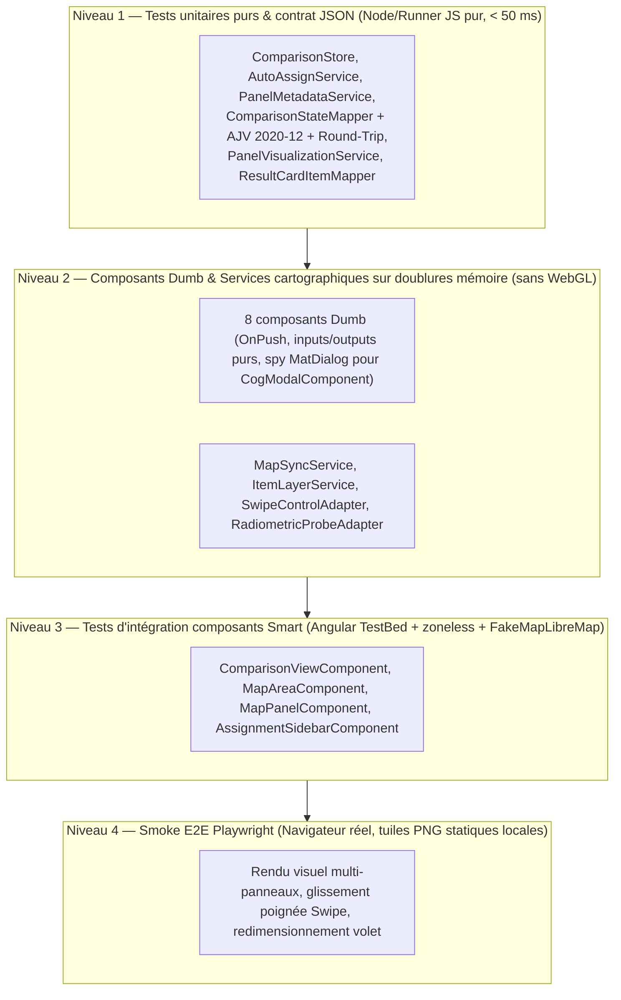

# Spécification technique — Stratégie de tests et matrice de traçabilité

> **Référentiel source** : *Spécification fonctionnelle : Comparaison de visualisations d'imagerie (V1)* (`05-spec-comparaison-visu-raster-v1.md`).  
> **Voir aussi** : `00-index-adr.md` · `01-modele-etat.md` · `02-composants-services.md` · `03-algorithmes.md` · `04-integration-maplibre.md` · `schema/comparison-state.schema.json`

---

## 8. Stratégie de tests automatisés sans WebGL

### 8.1 Pyramide de tests et exécution déterministe en CI

MapLibre GL JS requérant un contexte WebGL souvent indisponible ou instable sur les runners CI headless, l'architecture découple intégralement la logique métier, la réactivité Angular Signals et l'orchestration cartographique de l'instanciation GPU réelle :



### 8.2 Inversion d'instanciation et doublures mémoire sans WebGL (`FakeMapLibreMap` & `FakeSwipeControl`)

Afin d'interdire tout `new maplibregl.Map(...)` ou `new SwipeControl(...)` codé en dur dans les composants/adaptateurs, deux fabriques injectables sont définies :

```typescript
/** Sous-ensemble minimal de maplibregl.Map consommé par MapPanelComponent, MapSyncService et ItemLayerService */
export type MapLike = Pick<
  maplibregl.Map,
  | 'on'
  | 'off'
  | 'once'
  | 'remove'
  | 'resize'
  | 'getCenter'
  | 'getZoom'
  | 'getBearing'
  | 'getPitch'
  | 'jumpTo'
  | 'easeTo'
  | 'fitBounds'
  | 'zoomIn'
  | 'zoomOut'
  | 'resetNorthPitch'
  | 'setStyle'
  | 'isStyleLoaded'
  | 'setProjection'
  | 'setTerrain'
  | 'getSource'
  | 'addSource'
  | 'removeSource'
  | 'getLayer'
  | 'addLayer'
  | 'moveLayer'
  | 'removeLayer'
  | 'setPaintProperty'
  | 'setLayoutProperty'
  | 'addControl'
  | 'removeControl'
>;

export interface SwipeControlOptions {
  readonly orientation?: 'vertical' | 'horizontal';
  readonly position?: number;
  readonly showPanel?: boolean;
  readonly mousemove?: boolean;
  readonly active?: boolean;
  readonly basemapLayerIds?: readonly string[];
  readonly leftLayers?: readonly string[];
  readonly rightLayers?: readonly string[];
  readonly className?: string;
}

export interface SwipeControlLike extends maplibregl.IControl {
  getComparisonMap(): MapLike | null;
  setPosition(positionPct: number): void;
  setLeftLayers(layerIds: readonly string[]): void;
  setRightLayers(layerIds: readonly string[]): void;
  on(type: 'slide' | 'slideend', listener: (ev: { position?: number }) => void): void;
  off(type: 'slide' | 'slideend', listener: (ev: { position?: number }) => void): void;
}

export const MAPLIBRE_MAP_FACTORY = new InjectionToken<(opts: maplibregl.MapOptions) => MapLike>(
  'MAPLIBRE_MAP_FACTORY',
  { providedIn: 'root', factory: () => (opts) => new maplibregl.Map(opts) }
);

export const SWIPE_CONTROL_FACTORY = new InjectionToken<(opts: SwipeControlOptions) => SwipeControlLike>(
  'SWIPE_CONTROL_FACTORY',
  { providedIn: 'root', factory: () => (opts) => new SwipeControl(opts) }
);
```

En tests unitaires et d'intégration (Niveaux 2 et 3), ces tokens fournissent `FakeMapLibreMap` et `FakeSwipeControl` en mémoire pure :
* **`FakeMapLibreMap`** maintient de façon synchrone :
  * `camera` (`center`, `zoom`, `bearing`, `pitch`) mis à jour par `jumpTo`, `easeTo`, `zoomIn`, `zoomOut`, `resetNorthPitch`, `fitBounds` ;
  * `projection` (vérification formelle que `setProjection({ type: 'mercator' })` écrase tout style externe en `'globe'` — RF-15) ;
  * `sources: Map<string, SourceSpec>` et `layers: LayerSpec[]` ordonnés (support exact de `addLayer(spec, beforeId)`, `moveLayer(id, beforeId)`, `removeLayer`, `setPaintProperty`, `setLayoutProperty`) ;
  * `terrain` (`setTerrain`) et un compteur `resizeCount` ;
  * un bus d'événements synchrone exposant aux tests les déclencheurs `emitStyleLoad()`, `emitMove(nextCamera)`, `emitMouseMove(lngLat)`, `emitSourceLoaded(sourceId)` et `emitSourceError(sourceId, status)`.
* **`FakeSwipeControl`** crée en mémoire une seconde instance `FakeMapLibreMap` retournée par `getComparisonMap()`, trace `leftLayers`, `rightLayers`, `position` et expose `simulateSlide(pct)` pour vérifier la mise à jour de `ComparisonStore.swipePosition` et le démontage `onRemove()` sans fuite lors d'un basculement de disposition (RF-09, RF-10).

### 8.3 Suites de tests normatives par brique

1. **Services purs & `ComparisonStore` (Niveau 1 — couverture cible $\ge 95\%$ des branches)** :
   * **`AutoAssignService`** :
     * `assignByConstellation` : $\le N$ constellations, $> N$ constellations avec départage par date max puis ordre alphabétique, tri final des panneaux `P1..PN` par effectif décroissant puis ordre alphabétique (CA-04), exclusion des items sans visualisation (RF-29/RF-33).
     * `assignByAcquisitionDate` : inséparabilité des items partageant la même minute UTC, rattachement systématique de l'item équidistant au groupe le plus récent (CA-03), $< N$ paliers temporels laissant les panneaux surnuméraires vides (RF-33), ordre chronologique croissant de `P1` à `PN` (RF-35).
     * `assignAllToEachPanel` : passage en mode `'multi'`, affectation à tous les panneaux actifs et initialisation de la visualisation par défaut (CA-05).
   * **`PanelMetadataService`** : calcul strict sur les seuls items compatibles et `'loaded'`, moyenne arithmétique exacte, masquage de `Du ... au ... UTC` si 1 item ou même minute UTC, indépendance vis-à-vis du fuseau horaire système (`TZ=UTC`, `TZ=America/Los_Angeles`, `TZ=Pacific/Auckland` — RF-04, RF-22, RF-23, CA-08).
   * **`PanelVisualizationService`** : calcul de l'union ordonnée du plus récent au plus ancien avec déduplication par `id`, calcul exact de `match: 'all' | 'partial'` (exclusion des visualisations absentes du panneau — RF-20, CA-09), sélection de `preview` depuis le premier item compatible avec repli data-URI.
   * **`ComparisonStateMapper` & Schéma JSON** :
     * Validation AJV (`ajv/dist/2020`) des payloads générés par `exportCurrentState()` contre `comparison-state.schema.json`.
     * Matrice exhaustive des 20 cas du 01 § 4.5 (vérification de l'ouverture non bloquante et des codes `StateRestoreWarning` attendus, incluant `schemaVersion` — RF-38).
     * Propriété d'idempotence Round-Trip (01 § 4.7) sur états nominaux, partiels et multi-panneaux (CA-13).
   * **`ComparisonStore`** (exécuté en mode zoneless) : transitions `side-by-side` $\leftrightarrow$ `swipe` (conservation `P1`/`P2` — RF-10), réduction 4 $\rightarrow$ 2 panneaux (désaffectation immédiate de `P3`/`P4` — RF-11), extension 2 $\rightarrow$ 3/4 panneaux (nouveaux panneaux vides sans auto-assignation — RF-12), repli `multi` $\rightarrow$ `single` conservant le premier panneau dans `P1..P4` (RF-31), maintien/recalcul de visualisation (RF-18/RF-19/CA-09), masquage de `'constellation'` lorsque `enableConstellationAutoAssign === false`.
2. **Services cartographiques sur `FakeMapLibreMap` (Niveau 2)** :
   * **`MapSyncService`** : vérification qu'un `emitMove` sur `P1` applique `jumpTo` sur `P2..P4` en **exactement 1 passe** sans réentrance infinie, synchronisation `applyTerrainToAll` et `applyBasemapToAll` (y compris sur `swipeComparisonMap` si présent).
   * **`ItemLayerService`** : vérification de l'ordre exact `getOrderedLayerIds()` du plus ancien en bas au plus récent en haut sous `arlas-cmp-raster-top-anchor` et sous `arlas-cmp-footprint-highlight` (RF-06, RF-28), mise à jour de `raster-opacity` sans recréer les sources (compteur `addSourceCount` constant — RF-16), isolation d'une source en `'error'` (RF-25, CA-12).
   * **`RadiometricProbeAdapter`** : test point-in-polygon sur `Polygon` et `MultiPolygon`, sélection de l'item rendu au sommet de la pile, retour immédiat `'—'` hors emprise, maintien des appels à `globalOpacity = 0` (CA-10), annulation `AbortController` lors de survols rapides.
3. **Composants Dumb & Smart (Niveaux 2 et 3 — `provideZonelessChangeDetection()`)** :
   * Grille miroir `PanelAssignmentGridComponent` sur les 4 dispositions (`1×2`, `1×3`, `2×2`), désélection au clic sur bouton radio actif en `'single'` (CA-06).
   * `ItemCardComponent` : passage de `showSelectionCheckbox = false` à `arlas-result-card-item`, relais de `'arlas-comparison-center'` vers `centerOnItem` et de `mouseenter`/`mouseleave` vers `cardHoverChange` (CA-02).
   * `VisualizationSelectorComponent` : ouverture de `CogModalComponent` via spy `MatDialog` avec les `CogVisualisationData` du panneau et émission du `name` sélectionné.

---

## 9. Matrice de traçabilité exhaustive (RF / CA $\rightarrow$ Architecture & Tests)

### 9.1 Couverture des Règles Fonctionnelles (`RF-01` à `RF-39`)

| ID | Exigence fonctionnelle (synthèse) | Composants & Services responsables | Sections tech. | Vérification automatisée |
|---|---|---|---|---|
| **RF-01** | Vue plein écran autonome, fermeture ramenant à l'écran appelant | `ComparisonViewComponent`, `ToolbarComponent` | 00 § ADR-01, 02 § 3.1.1, 02 § 3.1.2 | Intégration Niveau 3 (`closed` émis, destruction store) |
| **RF-02** | Cadrage initial auto sur l'emprise englobante hors état fourni | `ComparisonStore`, `ComparisonStateMapper`, `MapSyncService` | 02 § 3.2.5, 01 § 4.6, 04 § 5.1 | Unitaire `ComparisonStateMapper` + Niveau 2 `fitBoundsAll` |
| **RF-03** | Défaut à l'ouverture : « Côte à côte » (2 panneaux vides), manuel strict | `ComparisonStore`, `ComparisonStateMapper` | 01 § 4.2, 01 § 4.5, 01 § 4.6 | Unitaire `ComparisonStore.initialize(undefined)` |
| **RF-04** | Dates et heures en UTC strict à la minute (`JJ/MM/AAAA HH:mm UTC`) | `PanelMetadataService`, `ResultCardItemMapper` | 02 § 3.2.3, 02 § 3.2.9, 03 § 6.6 | Unitaire multi-fuseaux horaires (`formatUtcMinute`) |
| **RF-05** | Support de 2 à 4 panneaux simultanés, 1 groupe par panneau | `ComparisonStore`, `MapAreaComponent`, `MapPanelComponent` | 02 § 3.1.7, 02 § 3.1.9, 01 § 4.2 | Unitaire store + Intégration `MapAreaComponent` |
| **RF-06** | Items illimités par panneau ; mosaïque / empilement date croissante puis `id` | `ComparisonStore` (`panelStackBottomUp`), `ItemLayerService` | 02 § 3.2.6, 01 § 4.2, 04 § 5.4 | Niveau 2 `FakeMapLibreMap.getOrderedLayerIds()` |
| **RF-07** | Panneau vide maintenu ouvert sur fond de carte, en-tête épuré, légende/visu masquées | `MapPanelComponent`, `PanelHeaderComponent`, `PanelLegendComponent` | 02 § 3.1.9, 02 § 3.1.10, 02 § 3.1.12 | Unitaire `PanelHeaderComponent` (`state='empty'`) + Niveau 3 |
| **RF-08** | Sélecteur exclusif des 4 dispositions (`side-by-side`, `swipe`, `three-columns`, `grid-2x2`) | `ToolbarComponent`, `ComparisonStore`, `MapAreaComponent` | 02 § 3.1.2, 02 § 3.1.7, 01 § 4.2 | Unitaire `ToolbarComponent` + `ComparisonStore.setLayout` |
| **RF-09** | Mode Balayage 2 panneaux, poignée verticale à 50 %, en-têtes/légendes ancrés G/D | `SwipeControlAdapter`, `SwipeContainerComponent`, `PanelHeaderComponent`, `PanelLegendComponent` | 00 § ADR-02, 02 § 3.1.8, 02 § 3.2.8, 04 § 5.3 | Niveau 2 `FakeSwipeControl` + `SwipeContainerComponent` |
| **RF-10** | Conservation intégrale de `P1`/`P2` et de leurs visus entre Côte à côte et Balayage | `ComparisonStore`, `MapAreaComponent`, `SwipeControlAdapter` | 00 § ADR-02, 01 § 4.2, 04 § 5.3 | Unitaire `ComparisonStore` + Intégration Niveau 3 |
| **RF-11** | Réduction du nombre de panneaux $\rightarrow$ désaffectation immédiate des panneaux retirés | `ComparisonStore.setLayout` | 01 § 4.2 | Unitaire `ComparisonStore` (4 $\rightarrow$ 2, 3 $\rightarrow$ 2, 4 $\rightarrow$ 3) |
| **RF-12** | Ajout de panneaux $\rightarrow$ maintien de l'existant, nouveaux panneaux vides, grille étendue | `ComparisonStore.setLayout`, `PanelAssignmentGridComponent` | 02 § 3.1.6, 01 § 4.2 | Unitaire `ComparisonStore` + `PanelAssignmentGridComponent` |
| **RF-13** | Synchronisation permanente caméra, Nord, inclinaison, relief 3D et fond de carte | `MapSyncService`, `ComparisonStore`, `SwipeControlAdapter` | 02 § 3.2.5, 04 § 5.2, 04 § 5.3 | Niveau 2 `MapSyncService` (garde anti-boucle + sync esclave) |
| **RF-14** | Bloc unique de contrôles cartographiques mutualisés (Zoom, Nord, 3D/2D, Fond) | `SharedMapControlsComponent`, `MapAreaComponent`, `MapSyncService` | 02 § 3.1.7, 02 § 3.1.13, 04 § 5.1 | Unitaire `SharedMapControlsComponent` + Niveau 2 `MapSyncService` |
| **RF-15** | Exclusion formelle du mode Globe (verrouillage Mercator) | `MapPanelComponent`, `MapSyncService`, `SharedMapControlsComponent` | 02 § 3.1.13, 04 § 5.1, 04 § 5.2 | Niveau 2 `FakeMapLibreMap` (`projection === 'mercator'` après `setStyle`) |
| **RF-16** | Curseur unique d'opacité globale (0–100 %, défaut 100 %) sur tous les panneaux | `ToolbarComponent`, `ComparisonStore`, `ItemLayerService`, `SwipeControlAdapter` | 02 § 3.1.2, 02 § 3.2.6, 04 § 5.4 | Niveau 2 `updateRasterOpacity` sans recréation de source |
| **RF-17** | Visualisation indépendante par panneau partagée par tous les items du panneau | `ComparisonStore`, `PanelHeaderComponent`, `VisualizationSelectorComponent`, `ItemLayerService` | 00 § ADR-07, 02 § 3.1.11, 01 § 4.2 | Unitaire `ComparisonStore.setPanelVisualization` |
| **RF-18** | Initialisation auto de la visu d'un panneau vide sur le défaut de l'item le plus récent | `ComparisonStore`, `PanelVisualizationService` | 02 § 3.2.10, 03 § 6.1, 03 § 6.5 | Unitaire `reconcilePanelVisualization` (`defaultVisualizationId` / `[0]`) |
| **RF-19** | Maintien de la visu aux ajouts/retraits ; recalcul si plus aucun item compatible | `ComparisonStore` | 01 § 4.2, 03 § 6.5 | Unitaire `ComparisonStore` (ajout/retrait unitaire) |
| **RF-20** | Sélecteur d'union via `CogModalComponent` ; masquage et badge sur item incompatible | `PanelVisualizationService`, `VisualizationSelectorComponent`, `ItemCardComponent` | 00 § ADR-07, 02 § 3.1.5, 04 § 5.7 | Unitaire `buildPanelModalData` (`'all'\|'partial'`) + badge carte |
| **RF-21** | Légende synchronisée au survol (item au sommet, opacité 0 % incluse, `« — »` hors emprise) | `PanelLegendComponent`, `RadiometricProbeAdapter`, `ComparisonStore` | 00 § ADR-04, 02 § 3.1.12, 04 § 5.5, 04 § 5.7 | Niveau 2 `RadiometricProbeAdapter` (inclusion géométrique + 0 %) |
| **RF-22** | En-tête calculé uniquement sur items compatibles rendus : Constellations, Visu, Date moy. UTC, Étendue | `PanelMetadataService`, `ComparisonStore`, `PanelHeaderComponent` | 02 § 3.1.10, 02 § 3.2.3, 03 § 6.6 | Unitaire `PanelMetadataService` + exclusion items en erreur/incompatibles |
| **RF-23** | Masquage de l'étendue temporelle si 1 seul item affiché ou même minute UTC | `PanelMetadataService`, `PanelHeaderComponent` | 02 § 3.2.3, 03 § 6.6 | Unitaire `computeHeaderMetadata` (`temporalExtentUtcLabel === null`) |
| **RF-24** | Indicateur de progression non bloquant par panneau pendant le chargement | `MapPanelComponent`, `SwipeContainerComponent`, `ItemLayerService`, `ComparisonStore` | 02 § 3.1.8, 02 § 3.1.9, 04 § 5.4 | Niveau 2/3 (`sourcedata` `'loading'` $\rightarrow$ `'loaded'`, navigation active) |
| **RF-25** | Isolation d'erreur par item (badge volet) ; message d'erreur panneau + maintien sélecteur si échec total | `ItemLayerService`, `ComparisonStore`, `MapPanelComponent`, `PanelHeaderComponent`, `ItemCardComponent` | 02 § 3.1.5, 02 § 3.1.10, 01 § 4.2, 04 § 5.4 | Niveau 2/3 (`emitSourceError` partiel vs total `all-errored`) |
| **RF-26** | Volet latéral gauche escamotable et redéployable avec redimensionnement des cartes | `AssignmentSidebarComponent`, `MapAreaComponent`, `ComparisonStore`, `MapSyncService` | 02 § 3.1.3, 02 § 3.1.7 | Niveau 3 (`setSidebarOpen` + `mapSync.resizeAll()`) |
| **RF-27** | Liste triée par date UTC DESC puis `id`, cartes composites 2 étages (`arlas-result-card-item` + bandeau) | `ComparisonStore`, `ResultCardItemMapper`, `AssignmentSidebarComponent`, `ItemCardComponent` | 00 § ADR-06, 02 § 3.1.5, 02 § 3.2.9, 04 § 5.6, 03 § 6.1 | Unitaire `compareItemsMostRecentFirst` + `ResultCardItemMapper` + Niveau 2 |
| **RF-28** | Surbrillance du contour d'emprise au survol de carte et action « Centrer sur l'item » | `ItemCardComponent`, `AssignmentSidebarComponent`, `ItemLayerService`, `MapSyncService` | 02 § 3.1.5, 02 § 3.2.6, 04 § 5.4, 04 § 5.6 | Niveau 2 (`updateHighlightedFootprint` + `fitBoundsAll` sur action) |
| **RF-29** | Item sans visualisation : mention dédiée, contrôles désactivés, ignoré par l'auto-assignation | `ComparisonStore`, `ItemCardComponent`, `AutoAssignService` | 02 § 3.1.5, 01 § 4.2, 03 § 6.1 | Unitaire `AutoAssignService` + `ItemCardComponent` (`isVisualizable=false`) |
| **RF-30** | Commutateur individuel Choix unique (défaut, décochable au clic) / Multi-panneaux | `ItemCardComponent`, `PanelAssignmentGridComponent`, `ComparisonStore` | 02 § 3.1.5, 02 § 3.1.6, 01 § 4.2 | Unitaire `toggleItemPanelAssignment` (`single` vs `multi`) |
| **RF-31** | Repli Multi-panneaux $\rightarrow$ Choix unique conservant le 1er panneau dans l'ordre `P1..P4` | `ComparisonStore.setItemAssignmentMode` | 01 § 4.2 | Unitaire `ComparisonStore` (`['P2','P4'] -> ['P2']` + recalcul RF-19 sur `P4`) |
| **RF-32** | Grille miroir `[P1]..[PN]` calquée sur la disposition active (1 ligne 2/3 col., 2 lignes 2x2) | `PanelAssignmentGridComponent` | 02 § 3.1.6 | Unitaire DOM `PanelAssignmentGridComponent` |
| **RF-33** | Règles communes d'auto-assignation (réinitialisation totale, respect disposition, panneaux vides) | `AutoAssignMenuComponent`, `ComparisonStore`, `AutoAssignService` | 02 § 3.1.4, 02 § 3.2.2, 03 § 6.2–6.4 | Unitaire `AutoAssignService` + `enableConstellationAutoAssign` |
| **RF-34** | Auto-assignation « Par constellation » (effectif DESC puis alpha ; départage date max puis alpha) | `AutoAssignService.assignByConstellation` | 02 § 3.2.2, 03 § 6.2 | Unitaire `assignByConstellation` |
| **RF-35** | Auto-assignation « Par date / période » (DP variance minimale, minutes inséparables, équidistance $\rightarrow$ récent) | `AutoAssignService.assignByAcquisitionDate` | 02 § 3.2.2, 03 § 6.3 | Unitaire `assignByAcquisitionDate` |
| **RF-36** | Auto-assignation « Tous les items dans chaque panneau » (mode Multi, visu défaut du plus récent) | `AutoAssignService.assignAllToEachPanel` | 02 § 3.2.2, 03 § 6.4 | Unitaire `assignAllToEachPanel` |
| **RF-37** | Ouverture directe dans une configuration fournie par `initialState` (`ComparisonState`) | `ComparisonViewComponent`, `ComparisonStateMapper`, `ComparisonStore` | 00 § ADR-03, 02 § 3.2.4, 01 § 4.3–4.6 | Unitaire `fromExternalState` + Intégration Niveau 3 |
| **RF-38** | Tolérance non bloquante aux paramètres omis, items absents/sans visu et visus incompatibles | `ComparisonStateMapper`, `ComparisonViewComponent` (`stateRestoreWarnings`) | 01 § 4.3, 01 § 4.5, 01 § 4.6, 01 § 4.8 | Unitaire matrice des 20 cas (01 § 4.5) |
| **RF-39** | Action « Exporter l'état » extrayant à tout moment le `ComparisonState` courant complet | `ToolbarComponent`, `ComparisonStore.exportCurrentState`, `ComparisonStateMapper`, `ComparisonViewComponent` | 00 § ADR-03, 01 § 4.3, 01 § 4.4, 01 § 4.7 | Unitaire AJV Schema + Round-Trip (01 § 4.7) |

---

### 9.2 Couverture des Critères d'Acceptation (`CA-01` à `CA-13`)

| Critère | Intitulé fonctionnel | RF couvertes | Scénario de test automatisé correspondant |
|---|---|---|---|
| **CA-01** | État initial par défaut à l'ouverture, cadrage géographique et référentiel UTC | RF-01, RF-02, RF-03, RF-04, RF-07, RF-16, RF-27, RF-30 | Test d'intégration Niveau 3 sur `ComparisonViewComponent` sans `initialState` (3 items) : vérifie `fitBoundsAll`, `globalOpacity = 100`, `layout = 'side-by-side'`, en-têtes `P1`/`P2` vides, tri UTC DESC et mode `'single'` désélectionné |
| **CA-02** | Repérage spatial, centrage rapide et rétractabilité du volet latéral | RF-26, RF-27, RF-28 | Test Niveau 3 : `mouseenter` sur `ItemCardComponent` met à jour GeoJSON `arlas-cmp-footprint-highlight` sur toutes les `FakeMapLibreMap` ; action `'arlas-comparison-center'` invoque `fitBoundsAll(item.bbox)` ; repli du volet déclenche `resizeAll()` |
| **CA-03** | Auto-assignation par date / période (ordre, inséparabilité et équidistance) | RF-33, RF-35 | Test unitaire `AutoAssignService.assignByAcquisitionDate` avec 2 items au `10/08 10:15 UTC`, 1 au `20/08 10:15 UTC`, 1 au `30/08 10:15 UTC` sur 2 panneaux $\rightarrow$ `P1 = [10/08 x2]`, `P2 = [30/08, 20/08]` |
| **CA-04** | Auto-assignation par constellation (dépassement du nombre de panneaux et départage) | RF-33, RF-34 | Test unitaire `AutoAssignService.assignByConstellation` en Grille 2x2 sur 9 items / 6 constellations (3×2 items + 3×1 item) $\rightarrow$ `P1..P3` alpha des paires, `P4` singleton le plus récent, 2 items libres |
| **CA-05** | Auto-assignation « Tous les items dans chaque panneau » | RF-18, RF-33, RF-36 | Test unitaire `AutoAssignService.assignAllToEachPanel` en `three-columns` sur 2 items $\rightarrow$ mode `'multi'`, `P1..P3` contiennent les 2 items avec la visu par défaut du plus récent |
| **CA-06** | Affectation manuelle, retrait au clic et repli Multi-panneaux vers Choix unique | RF-07, RF-30, RF-31 | Test unitaire `ComparisonStore` : item en `'multi'` sur `['P2','P3']` basculé en `'single'` $\rightarrow$ `['P2']` seul ; clic sur `P2` $\rightarrow$ `[]`, `P2` passe à l'état vide RF-07 |
| **CA-07** | Transitions de disposition (Côte à côte, Balayage, réduction et ajout de panneaux) | RF-08, RF-09, RF-10, RF-11, RF-12, RF-32 | Test Niveau 3 : `grid-2x2` $\rightarrow$ `side-by-side` (`P3`/`P4` vidés, grille `1×2`) $\rightarrow$ `swipe` (`SwipeControl` attaché à 50 %, groupes/visus `P1`/`P2` intacts, overlays G/D) $\rightarrow$ `three-columns` (`P3` vide) |
| **CA-08** | Empilement déterministe et calcul des métadonnées d'en-tête en UTC | RF-04, RF-06, RF-22, RF-23 | Test unitaire `PanelMetadataService` + Niveau 2 `ItemLayerService` (`10/08 10:00Z` sous `12/08 14:00Z`, moyenne `11/08/2026 12:00 UTC` + étendue `Du ... au ... UTC`, puis masquage de l'étendue après retrait du `10/08`) |
| **CA-09** | Visualisations par panneau, maintien/recalcul et hétérogénéité des capteurs | RF-17, RF-18, RF-19, RF-20, RF-22 | Test unitaire `ComparisonStore` + `PanelVisualizationService` : ajout item S1 incompatible dans `P1` (S2 actif) $\rightarrow$ maintien « Vraies couleurs », `CogModalComponent` reçoit l'union avec `match: 'partial'`, badge incompatible sur S1, métadonnées S2 seul ; retrait S2 $\rightarrow$ bascule auto sur visu défaut de S1 |
| **CA-10** | Lecture radiométrique synchronisée au survol, hors emprise et opacité globale à 0 % | RF-16, RF-21 | Test Niveau 2 `RadiometricProbeAdapter` + `ItemLayerService` à `globalOpacity = 0` : survol dans l'emprise de `P1` mais hors de `P2` $\rightarrow$ valeur sonde sur `P1` et `'—'` sur `P2` |
| **CA-11** | Synchronisation cartographique permanente et contrôles mutualisés (sans Globe) | RF-13, RF-14, RF-15 | Test Niveau 2 `MapSyncService` + `SharedMapControlsComponent` sur 3 `FakeMapLibreMap` : pan, zoom, `resetNorthAndPitch`, bascule 3D/2D et `applyBasemapToAll` répliqués à l'identique, `projection: 'mercator'` maintenue |
| **CA-12** | Gestion des items sans visualisation, du chargement et des erreurs d'affichage | RF-24, RF-25, RF-29 | Test Niveau 3 : item sans visu désactivé dans le volet ; spinner actif tant qu'une source est `'loading'` ; `emitSourceError` sur 1 des 2 items $\rightarrow$ item sain affiché + badge erreur volet ; retrait de l'item sain $\rightarrow$ état `'all-errored'` avec maintien du sélecteur de visualisation |
| **CA-13** | Export de l'état courant et ouverture directe avec un état fourni (tolérance incluse) | RF-37, RF-38, RF-39 | Test unitaire `ComparisonStateMapper` (AJV + Round-Trip en `three-columns`, opacité `65`, cadrage exact, item inconnu ignoré avec `UNKNOWN_ITEM_IGNORED`) + Test Niveau 3 `stateExported` / `initialState` |

